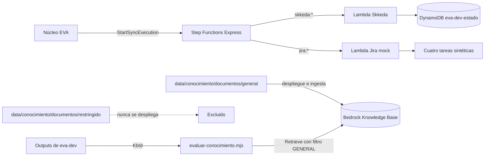

# Diseño

## Resumen

El frente **conocimiento-y-acciones** entrega, en este orden:

1. Un corpus corporativo sintético de 12 documentos generales y 2 restringidos, con metadatos adyacentes y 23 casos de evaluación.
2. Una Lambda mock de Skkeda para crear, listar y cancelar reservas de puestos con persistencia en DynamoDB.
3. Una Lambda mock de Jira de solo lectura con cuatro tareas fijas.
4. Un script que evalúa la recuperación de la Knowledge Base desplegada.

El diseño conserva `src/comun/contrato.ts` sin cambios. Solo Step Functions invoca los conectores. El modelo no recibe conectores, DynamoDB, URLs, credenciales ni secretos. El contenido restringido nunca llega al bucket y toda llamada `Retrieve` usa el filtro `classification = GENERAL`.

Los contratos HTTP y `X-Mock-Scenario` son referencias funcionales. Las Lambdas reciben `InvokeRequest`, no peticiones HTTP; por eso no implementan OAuth, Jira real, reservas ejecutables de salas, cabeceras HTTP ni latencia artificial.

## Estado actual y objetivo

| Pieza | Estado actual | Objetivo |
|---|---|---|
| Corpus general | 9 documentos | 12 documentos completos y consistentes |
| Corpus restringido | 2 documentos | 2 documentos renumerados en la secuencia única y nunca desplegados |
| Evaluación | 12 positivos, 3 `NO_ANSWER`, 1 `INVESTIGACION` | 15 positivos, 5 `NO_ANSWER`, 3 `INVESTIGACION` |
| Skkeda | Handler stub | Mock persistente, concurrente e idempotente |
| Jira | Handler stub | Mock de lectura con filtros determinísticos |
| Evaluador | No existe | Script de solo lectura contra una Knowledge Base ya ingerida |

## Arquitectura

## Límites de responsabilidad

| Componente | Hace | No hace |
|---|---|---|
| Corpus | Define la fuente sintética y citable | No ejecuta acciones ni contiene datos reales |
| Skkeda | Valida y persiste reservas ya autorizadas | No confirma acciones, decide permisos ni invoca el modelo |
| Jira | Filtra tareas sintéticas de la persona solicitante | No persiste, usa OAuth ni escribe en Jira |
| Evaluador | Mide recuperación de una KB ya ingerida | No inicia ingesta, genera respuestas ni imprime pasajes |
| Núcleo y Policy Engine | Proponen, autorizan y confirman | No se modifican desde este spec |

## Parte A: corpus

### Inventario objetivo

Se ajustan los nueve documentos generales actuales y se agregan tres. Los dos restringidos se renumeran para mantener identificadores continuos y únicos.

| `documentId` | Archivo | Tipo | Cobertura principal |
|---|---|---|---|
| `DOC-SYN-0001` | `politica-viajes.md` | Política | Viajes nacionales e internacionales |
| `DOC-SYN-0002` | `reserva-puestos-salas.md` | Guía | Puestos, pisos, cancelación y salas como conocimiento |
| `DOC-SYN-0003` | `trabajo-hibrido.md` | Política | Presencialidad y conectividad |
| `DOC-SYN-0004` | `soporte-ti.md` | Guía | Canales y tiempos por prioridad |
| `DOC-SYN-0005` | `vacaciones-permisos.md` | Política | Vacaciones y permisos |
| `DOC-SYN-0006` | `seguridad-informacion.md` | Política | Contraseñas, clasificación e incidentes |
| `DOC-SYN-0007` | `gastos-reembolsos.md` | Procedimiento | Soportes, topes, aprobaciones y legalización |
| `DOC-SYN-0008` | `onboarding.md` | Guía | Actividades de ingreso y primeros 30 días |
| `DOC-SYN-0009` | `gestion-cambios.md` | Procedimiento | Tipos, Comité, ventanas y congelamiento |
| `DOC-SYN-0010` | `beneficios-corporativos.md` | Preguntas frecuentes | Beneficios, montos, condiciones y vigencias |
| `DOC-SYN-0011` | `teams-correo-corporativo.md` | Guía | Uso aceptable de Teams y correo, sin integración |
| `DOC-SYN-0012` | `continuidad-operativa.md` | Guía | Canales, responsables y tiempos, sin duplicar soporte |
| `DOC-SYN-0013` | `restringido/tabla-salarial.md` | Tabla restringida | Salarios sintéticos por cargo |
| `DOC-SYN-0014` | `restringido/plan-reestructuracion.md` | Plan restringido | Cambios organizacionales sintéticos |

El evaluador descubre los IDs restringidos desde los metadatos y no codifica `DOC-SYN-0013` ni `DOC-SYN-0014`.

### Forma documental

Cada Markdown, general o restringido, tiene:

1. Primera línea exacta `Documento sintético para demostración`.
2. Un título `#` igual a `metadataAttributes.title`.
3. Entre 3 y 6 secciones `##`.
4. Cifras y fechas concretas.
5. Solo personas, dominios, identificadores y situaciones sintéticas.

Cada archivo `x.md.metadata.json` contiene `classification`, `documentId`, `title`, `area` y `updatedAt`. La clasificación coincide con la carpeta y `updatedAt` es una fecha válida `AAAA-MM-DD`.

Antes de entregar el corpus se ejecuta una validación local que comprueba:

- conteos y pares Markdown/metadatos;
- IDs únicos y secuencia completa;
- primera línea, título y 3 a 6 secciones;
- coincidencia entre H1 y `title`;
- clasificación según carpeta;
- presencia literal de cada `fraseClave` positiva;
- ausencia en `general/` de frases, cifras y hechos exclusivos extraídos de salario y reestructuración;
- revisión humana cruzada para detectar resúmenes o paráfrasis de esos hechos restringidos.

La comprobación automática detecta copias y variantes normalizadas; no pretende demostrar por sí sola ausencia semántica. La revisión humana completa el criterio que prohíbe resumir contenido restringido bajo metadatos `GENERAL`. Ninguna comprobación imprime el contenido restringido.

### Datos canónicos de demo

| Tema | Regla sintética |
|---|---|
| Viaje nacional | 5 días hábiles; máximo COP 280.000 por día |
| Viaje internacional | 15 días hábiles; máximo COP 480.000 por día; aprobación adicional de Vicepresidencia |
| Cartagena por 3 días | Viaje nacional; máximo COP 840.000; legalización en 5 días hábiles después del regreso |
| Gastos de viaje | Plazo especial de 5 días hábiles; el plazo general de 30 días solo aplica a gastos no asociados a viajes |
| Skkeda | Un puesto por persona y día; cancelación hasta las 8:00 a. m. |
| Pisos | Piso 2 `P-1`–`P-14`; piso 3 `P-15`–`P-27`; piso 4 `P-28`–`P-40` |
| Soporte alto | Respuesta en 4 horas |
| Vacaciones | 15 días hábiles por año |
| Contraseña | Cambio cada 90 días |
| Reembolso mayor de COP 500.000 | Aprueba Gerencia Financiera |
| Comité de Cambios | Martes a las 9:00 a. m. |
| Congelamiento | Del 15 de diciembre al 10 de enero |

La hora de cancelación es conocimiento consultable. El conector no la aplica porque `InvokeRequest` no transporta una hora y la Parte B no exige esa regla.

### Casos de evaluación

`data/conocimiento/evaluacion.json` conserva `{ descripcion, preguntas }`. La lista contiene:

| Tipo | Forma | Cantidad |
|---|---|---:|
| Positiva | `{ pregunta, documentId, fraseClave }` | 15 |
| Sin respuesta | `{ pregunta, esperado: "NO_ANSWER" }` | 5 |
| Investigación | `{ pregunta, tipo: "INVESTIGACION", documentosEsperados }` | 3 |

Las positivas incluyen las preguntas de viajes, el seguimiento `¿Y si es internacional?` y la búsqueda del archivo de gestión de cambios. Las negativas incluyen salario, reestructuración, dólar, clima y resultado deportivo. Las dos primeras son **canarios de seguridad** porque su única fuente legítima está en `restringido/`.

Las preguntas de investigación combinan al menos dos documentos:

1. Cartagena, anticipación, viáticos y legalización: `DOC-SYN-0001` y `DOC-SYN-0007`.
2. Ingreso y trabajo híbrido: `DOC-SYN-0008`, `DOC-SYN-0003` y `DOC-SYN-0006`.
3. Trabajo remoto, comunicación e incidente técnico: `DOC-SYN-0003`, `DOC-SYN-0011` y `DOC-SYN-0004`.

## Contrato común

Los handlers usan `InvokeRequest` e `InvokeResult` de `src/comun/contrato.ts` sin modificarlos.

| Campo de entrada | Uso |
|---|---|
| `correlationId` | Se devuelve en toda respuesta |
| `capabilityId` | Selecciona una capacidad conocida |
| `userId` | Identidad derivada del token; nunca se toma de `params` |
| `groups` | Se recibe, pero el conector no recalcula permisos |
| `params` | Objeto cerrado por capacidad |
| `idempotencyKey` | Obligatoria en `WRITE` |

Toda salida usa `origin: "mock"`. Los errores incluyen un código estable y un mensaje genérico en español. Los logs nunca incluyen mensajes de error, excepciones, `userId`, parámetros, claves idempotentes ni contenido.

## Parte B: Skkeda

### Catálogo y validación

`data/skkeda/catalogo.json` mantiene list/create/cancel, pero `booking.create` se cierra al MVP:

- `kind` solo admite `puesto`;
- `resource` solo admite `P-1` a `P-40`;
- `slot` se elimina;
- `date` es obligatoria y debe ser una fecha calendario real;
- debe llegar `resource`, `floor` o ambos;
- si llegan ambos, deben corresponder.

El handler vuelve a validar el esquema en el límite de confianza. Una capacidad desconocida se rechaza antes de acceder a DynamoDB. Las escrituras sin `idempotencyKey` se rechazan antes de leer o escribir.

### Inyección

El módulo expone una fábrica local `crearHandler` con:

| Dependencia | Producción | Pruebas |
|---|---|---|
| Cliente documental | `DynamoDBDocumentClient` | Fake transaccional en memoria |
| Nombre de tabla | `TABLA_ESTADO` | Nombre sintético |
| Logger estructurado | Salida saneada | Espía |

El `handler` productivo se construye una vez para reutilizar conexiones.

### Modelo DynamoDB

Solo se usan las tres familias asignadas en `contrato-mvp.md` §6.

| Entidad | `pk` | `sk` | Atributos principales |
|---|---|---|---|
| Ocupación activa | `SKKEDA#<fecha>` | `<recurso>` | `userId`, `code`, `floor`, `date`, `status: ACTIVE`, `version` |
| Día de la persona | `SKKEDA-USR#<userId>` | `<fecha>` | `status`, reserva activa opcional, `version`, mapa `idempotency` |
| Reserva por código | `SKKEDA-BK#<código>` | `BK` | `userId`, `date`, `resource`, `floor`, `status`, `version` |

El mapa `idempotency` del ítem diario guarda por clave: `capabilityId`, estado, datos normalizados y código/mensaje genérico de error. No persiste `correlationId`; al reproducir un resultado usa la correlación de la invocación actual.

Al cancelar, el ítem diario queda como tombstone `CANCELLED`. Conserva el historial idempotente y deja de contar para el límite diario.

### Código y piso

El código es `BK-SYN-<AAAAMMDD>-P<número>`. Ejemplo: `BK-SYN-20261126-P15`.

| Recurso | Piso |
|---|---:|
| `P-1`–`P-14` | 2 |
| `P-15`–`P-27` | 3 |
| `P-28`–`P-40` | 4 |

`P-12` se incorpora siempre al conjunto ocupado como reserva virtual de `SYN-USR-0099`.

### Creación

1. Leer consistentemente el ítem diario.
2. Si existe la `idempotencyKey`, reproducir el resultado.
3. Si el día está `ACTIVE`, registrar y devolver `DAILY_LIMIT` sin alternativas.
4. Consultar las ocupaciones de la fecha y agregar `P-12`.
5. Para recurso explícito, usarlo como candidato. Para piso, elegir el primer libre en orden numérico.
6. Si el candidato está ocupado, registrar y devolver `RESOURCE_TAKEN` con alternativas.
7. Si está libre, ejecutar una transacción condicionada que crea la ocupación, activa el día de la persona, crea/reactiva el registro por código y registra el resultado idempotente.
8. Una creación exitosa devuelve exactamente `status: "OK"`, `origin: "mock"` y `data: { code, resource, floor, date }`.
9. Ante cancelación condicional, discriminar siempre en este orden:
   1. releer idempotencia y reproducir el resultado si otra invocación ganó con la misma clave;
   2. releer el día y devolver `DAILY_LIMIT` si otra solicitud de la persona ganó;
   3. comprobar la ocupación del candidato;
   4. solo para asignación por piso, avanzar al siguiente puesto si el candidato fue ocupado por otra persona.
10. Los demás errores DynamoDB producen `UNAVAILABLE/SOURCE_UNAVAILABLE`.

El ciclo por piso está limitado al tamaño del piso, máximo 14 intentos. Dos solicitudes simultáneas con la misma clave convergen al mismo resultado; dos solicitudes de la misma persona con claves distintas producen un `OK` y un `DAILY_LIMIT`.

### Alternativas

Se calculan sobre `P-1` a `P-40`, excluyendo ocupaciones activas y `P-12`:

1. puestos libres del piso preferido, en orden numérico;
2. puestos libres de los otros pisos, por piso y número;
3. máximo 5 elementos `{ resource, floor }`.

Si no hay puestos se devuelve `RESOURCE_TAKEN` con `alternatives: []`. `DAILY_LIMIT` nunca contiene alternativas.

### Listado

`booking.list` consulta `SKKEDA-USR#<userId>` y devuelve exactamente:

`data: { bookings: Array<{ date, resource, floor, code }> }`

Solo incluye ítems `ACTIVE`. Con `date`, usa la clave de ordenamiento exacta. No devuelve tombstones ni datos de otra persona.

### Cancelación e idempotencia

1. Validar código e idempotencia.
2. Reproducir un resultado previo si el mapa diario contiene la clave.
3. Leer consistentemente `SKKEDA-BK#<código>`/`BK`.
4. Para código inexistente, cancelado o ajeno, guardar y devolver el mismo `NOT_FOUND`.
5. Para una reserva propia activa, ejecutar una transacción que elimina la ocupación, cambia el día y el registro por código a `CANCELLED` y guarda el resultado idempotente.
6. Ante condición fallida, releer idempotencia y estado antes de responder.

Repetir la misma clave devuelve el resultado original. Otra clave contra una reserva cancelada devuelve `NOT_FOUND`.

### Bloqueo contractual: cancelación obsoleta después de reservar de nuevo

El código aprobado depende solo de fecha y puesto. Si el mismo puesto se cancela y vuelve a reservar el mismo día, el código se reutiliza. Una acción de cancelación antigua, confirmada después de la nueva reserva con otra `idempotencyKey`, no puede distinguir ambas generaciones porque `booking.cancel` recibe únicamente `code`.

Ni condiciones DynamoDB ni el mapa idempotente resuelven esa ambigüedad: la nueva reserva vuelve a coincidir en código y propietario. Implementar la cancelación sin resolverla podría cancelar una reserva posterior que la persona no pretendía cancelar.

**Decisión recomendada antes de implementar la Parte B:** agregar un `bookingVersion` opaco al resultado de crear/listar y exigir `{ code, bookingVersion }` al cancelar. El conector compara ambos dentro de la transacción. Esto requiere acuerdo con las dueñas del núcleo y del contrato porque modifica el esquema de parámetros de la acción, aunque no exige cambiar los tipos genéricos de `src/comun/contrato.ts`.

Alternativas descartadas:

- impedir reservar de nuevo el puesto contradice que cancelar lo libera;
- agregar un sufijo al código contradice el formato aprobado;
- confiar solo en `idempotencyKey` no relaciona una acción de cancelación nueva con la generación que vio el núcleo.

Hasta que se apruebe `bookingVersion`, se puede completar la Parte A. La Parte B no debe cerrarse y, para respetar el orden aprobado A → B → B2 → C, no se inicia B2 ni C.

### Concurrencia

Todas las escrituras usan `TransactWriteCommand` con condiciones de existencia, estado y versión. No se usa `Scan`. La disponibilidad consulta una sola partición, con máximo lógico de 40 ocupaciones.

## Parte B2: Jira

### Datos fijos

| `key` | `summary` | `status` | `priority` | `due` | Proyecto |
|---|---|---|---|---|---|
| `EVA-SYN-101` | Ajustar flujo de confirmación de EVA | `En curso` | `alta` | `2026-11-26` | `EVA` |
| `EVA-SYN-104` | Revisar citas de la base de conocimiento | `En revisión` | `media` | `2026-11-27` | `EVA` |
| `TI-SYN-220` | Actualizar guía sintética de soporte | `Por hacer` | `media` | `2026-12-01` | `TI` |
| `EVA-SYN-099` | Preparar datos sintéticos iniciales | `Hecho` | `baja` | `2026-11-20` | `EVA` |

Las cuatro tareas se consideran asignadas al `userId` autenticado. No se almacena ni expone otra identidad.

### Filtros

1. Solo se acepta `jira:issue.search`.
2. `params` admite exclusivamente `status?` y `project?`.
3. `status` predeterminado es `OPEN`; excluye `Hecho`.
4. `ALL` devuelve las cuatro tareas.
5. `project` compara exactamente con el prefijo anterior a `-SYN-`.
6. Sin coincidencias se devuelve `OK` con `data: { items: [] }`.

La respuesta exitosa es `data: { items }`. El módulo no usa DynamoDB, secretos, OAuth ni servicios externos.

## Errores y logs

| Caso | `status` | `error.code` |
|---|---|---|
| Capacidad desconocida | `DENIED` | `UNKNOWN_CAPABILITY` |
| Parámetros inválidos | `FAILED` | `INVALID_PARAMETER` |
| Falta clave en `WRITE` | `FAILED` | `MISSING_IDEMPOTENCY` |
| Puesto/piso sin disponibilidad | `CONFLICT` | `RESOURCE_TAKEN` |
| Reserva diaria existente | `CONFLICT` | `DAILY_LIMIT` |
| Código inexistente, ajeno o cancelado | `NOT_FOUND` | `NOT_FOUND` |
| Error no condicional de DynamoDB | `UNAVAILABLE` | `SOURCE_UNAVAILABLE` |

Los logs contienen solo `correlationId`, `capabilityId`, `status` y código técnico. No contienen `userId`, parámetros, contenido, claves idempotentes, mensajes ni excepciones.

## Parte C: evaluador

### Dependencias y precondición

`infra/scripts/evaluar-conocimiento.mjs` usa:

- `execFileSync` sin shell para leer `KbId` desde los outputs de `eva-dev` en `us-east-1`;
- `BedrockAgentRuntimeClient` y `RetrieveCommand`;
- credenciales del entorno de la operadora;
- `evaluacion.json` y metadatos restringidos.

La ingesta debe estar `COMPLETE`. El script no inicia ni modifica ingestas.

### Obtención de `KbId`

El script ejecuta AWS CLI con argumentos separados para consultar `eva-dev` en `us-east-1`. La resolución distingue:

1. **Stack inexistente o no accesible:** AWS CLI termina con error; se informa `No se pudo leer el stack eva-dev` sin reproducir stderr.
2. **Salida ilegible:** stdout no es JSON válido o no tiene la forma esperada; se informa `La salida del stack eva-dev no es válida`.
3. **Output ausente:** la salida es válida pero no contiene `OutputKey: KbId` o su valor está vacío; se informa `El stack eva-dev no expone KbId`.

Las tres ramas terminan antes de `Retrieve` y fijan un código de salida distinto de cero. Sus pruebas inyectan un ejecutor de procesos y nunca invocan AWS CLI real.

### Algoritmo

1. Validar que existan 15 positivos, 5 `NO_ANSWER` y 3 `INVESTIGACION`.
2. Omitir explícitamente los 3 de investigación.
3. Para cada uno de los 20 individuales, ejecutar `Retrieve` con 5 resultados y filtro `{ equals: { key: "classification", value: "GENERAL" } }`.
4. Normalizar internamente posición, score, `documentId` y texto; el texto nunca se incluye en el reporte.
5. Registrar una **falla de seguridad confirmada** si aparece un ID restringido en cualquier posición.
6. Para los dos canarios restringidos, registrar un **fallo de `NO_ANSWER`** si cualquier pasaje alcanza 0,5 aunque tenga ID general. El score por sí solo no se etiqueta como fuga, porque puede corresponder a ruido vectorial.
7. Si el texto de ese pasaje contiene un hecho restringido normalizado definido por la validación del corpus, elevarlo además a falla de seguridad confirmada. La revisión humana de la Parte A cubre paráfrasis que esta comparación no puede demostrar.
8. Para positivos, contar top-1 y top-3 por `documentId`.
9. Para los demás `NO_ANSWER`, contar acierto si no hay pasajes o el score máximo es menor que 0,5.
10. Ante error de `Retrieve`, registrar solo la posición, continuar y dejar `process.exitCode = 1`.
11. Calcular top-1/top-3 sobre 15 y `NO_ANSWER` sobre 5.
12. Una métrica baja se reporta pero no falla automáticamente, excepto los dos canarios restringidos y las fallas de seguridad confirmadas.

El reporte solo muestra conteos, porcentajes, posiciones, scores e IDs. Nunca imprime preguntas, pasajes, respuestas ni excepciones.

### Pruebas locales del evaluador

El `.mjs` separa funciones puras exportables de la función `main` y solo ejecuta `main` cuando es el punto de entrada. `infra/scripts/evaluar-conocimiento.test.ts`, junto al script, usa un proceso Node ESM para importar esas funciones sin ejecutar AWS.

Las pruebas cubren:

- conteos y omisión de investigación;
- resolución de `KbId`: stack ilegible/inaccesible, JSON inválido y output ausente;
- request exacto de `Retrieve`;
- top-1, top-3 y `NO_ANSWER`;
- cero resultados;
- separación entre ID restringido, canario con ruido y fuga confirmada por un hecho restringido;
- continuación y código de salida ante error;
- salida sin preguntas, pasajes, respuestas ni excepciones.

La prueba operativa real sigue siendo responsabilidad de la operadora.

## Estrategia de pruebas de conectores

### Skkeda

El fake DynamoDB evalúa condiciones y aplica transacciones de forma atómica.

| Grupo | Cobertura |
|---|---|
| Validación | Capacidad, esquema cerrado, fecha imposible, sala, puesto/piso inválido, falta recurso/piso e idempotencia |
| Creación | Recurso, pisos 2/3/4, cálculo de piso, código y payload exacto `{ code, resource, floor, date }` |
| Conflictos | `P-12`, ocupado, piso/inventario lleno, orden y límite de alternativas, `DAILY_LIMIT` |
| Idempotencia | Repetición de éxitos y errores con correlación actual |
| Concurrencia | Mismo puesto; misma persona con claves distintas; misma clave simultánea; asignación por piso |
| Listado | Forma `data.bookings`, fecha, identidad y tombstones |
| Cancelación | Propia, ajena, inexistente, repetida y liberación, condicionada a resolver `bookingVersion` |
| Fallas | DynamoDB y logs saneados |

### Jira

Las pruebas cubren capacidad, `OPEN`, `ALL`, estados inválidos, proyectos `EVA`/`TI`/vacío, propiedades adicionales, cuatro tareas completas, lista vacía, correlación y origen mock. No usan AWS.

Al terminar cada tarea posterior deben pasar `npm run build`, `npm test` y `npm run lint`.

## Trazabilidad

| Requisito | Diseño |
|---|---|
| 1 | Inventario, forma documental y validación local |
| 2 | Cobertura temática y datos canónicos |
| 3 | Metadatos, IDs, separación y control contra copias restringidas |
| 4 | Unión de 23 casos, canarios e investigación |
| 5 | Contrato, catálogo, identidad e inyección |
| 6 | Validación, pisos, código y transacciones |
| 7 | `P-12`, alternativas, concurrencia e idempotencia |
| 8 | `data.bookings`, cancelación genérica y bloqueo de versión |
| 9 | Fake atómico y matriz Skkeda |
| 10 | Cuatro tareas fijas y aislamiento |
| 11 | Filtros y pruebas Jira |
| 12 | `KbId`, `Retrieve`, métricas, canarios, salida y pruebas locales |

## Archivos previstos

Después de aprobar el diseño y crear `tasks.md`, la implementación se limita a:

- `data/conocimiento/documentos/general/*`
- `data/conocimiento/documentos/restringido/*`
- `data/conocimiento/evaluacion.json`
- `data/skkeda/catalogo.json` (incluida la descripción del código de cancelación y, si se aprueba, `bookingVersion`)
- `src/conectores/skkeda/handler.ts`
- `src/conectores/skkeda/handler.test.ts`
- `src/conectores/jira/handler.ts`
- `src/conectores/jira/handler.test.ts`
- `infra/scripts/evaluar-conocimiento.mjs`
- `infra/scripts/evaluar-conocimiento.test.ts`

No se prevén cambios en `src/comun/contrato.ts`, `src/nucleo/`, `infra/lib/` ni `src/portal/`. La solución recomendada para `bookingVersion` sí requiere coordinación con el frente de núcleo antes de implementarse.
