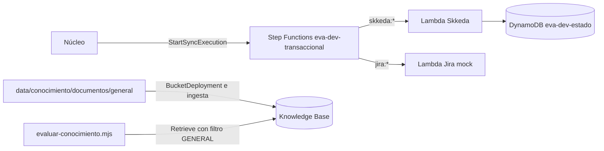

# Diseño

## Resumen

Dos Lambdas de conectores (Skkeda y Jira) que solo Step Functions invoca, más un script opcional de evaluación. El corpus ya existe en `data/conocimiento/`. Nada de este frente toca `src/nucleo/`, `infra/lib/` ni `src/portal/`.

## Arquitectura



## Corpus existente (viene en el kit, no se genera)

| Archivo | `documentId` | Título | Datos clave |
|---|---|---|---|
| `politica-viajes.md` | DOC-SYN-0001 | Política de viajes corporativos | Nacional 5 días hábiles de anticipación, internacional 15; viático COP 280.000/día nacional y USD 120/día internacional; internacional aprueba también la Vicepresidencia; legalización en 5 días hábiles |
| `reserva-puestos-salas.md` | DOC-SYN-0002 | Guía de reserva de puestos y salas en Skkeda | Un puesto por día, hasta 14 días antes; "## Pisos y puestos": piso 2 P-1–P-14, piso 3 P-15–P-27, piso 4 P-28–P-40; cancelar hasta las 8:00 a. m. |
| `trabajo-hibrido.md` | DOC-SYN-0003 | Política de trabajo híbrido | Días presenciales, horario, auxilio de conectividad |
| `soporte-ti.md` | DOC-SYN-0004 | Mesa de ayuda de tecnología | Extensión 4000 y Teams "Soporte TI"; crítica 1 h, alta 4 h, media 1 día hábil, baja 3 días hábiles |
| `vacaciones-permisos.md` | DOC-SYN-0005 | Vacaciones y permisos | 15 días hábiles por año |
| `seguridad-informacion.md` | DOC-SYN-0006 | Seguridad de la información | Contraseñas, incidentes, clasificación |
| `gastos-reembolsos.md` | DOC-SYN-0007 | Procedimiento de gastos y reembolsos | Soportes, plazo, montos y aprobaciones |
| `onboarding.md` | DOC-SYN-0008 | Guía de bienvenida para nuevos colaboradores | Primer día, accesos, cursos |
| `gestion-cambios.md` | DOC-SYN-0009 | Procedimiento de gestión de cambios de TI | Estándar, normal (CAB) y emergencia; CAB los martes 9:00 a. m.; ventana jueves 10:00 p. m.–2:00 a. m.; congelamiento 15 dic–10 ene |
| `restringido/tabla-salarial.md` | DOC-SYN-9001 | Tabla salarial por cargo | RESTRICTED: nunca se sube |
| `restringido/plan-reestructuracion.md` | DOC-SYN-9002 | Plan de reestructuración | RESTRICTED: nunca se sube |

`evaluacion.json` (12 preguntas): 9 con `{ pregunta, documentId, fraseClave }` y 3 con `{ pregunta, "esperado": "NO_ANSWER" }`. Documentos nuevos (opcional) van desde DOC-SYN-0010.

## Componentes e interfaces

### `src/conectores/skkeda/handler.ts`

```ts
export interface DependenciasSkkeda { doc: DynamoDBDocumentClient; tabla: string }
export function crearHandler(deps: DependenciasSkkeda): (s: InvokeRequest) => Promise<InvokeResult>;
export const handler = crearHandler({ doc: DynamoDBDocumentClient.from(new DynamoDBClient({})), tabla: process.env.TABLA_ESTADO ?? '' });
export const pisoDe = (puesto: string): 2 | 3 | 4; // n ≤ 14 → 2; n ≤ 27 → 3; si no → 4
```

| Capacidad | Parámetros (catálogo) | Lógica |
|---|---|---|
| `skkeda:booking.create` | `kind`, `date`, `floor?`, `resource?` | Validar → idempotencia → límite diario → ocupados del día (+ `P-12`) → libres ordenados con el piso preferido primero (`floor` o el piso del puesto pedido) → asignar → `TransactWriteCommand` con 3 `Put` condicionados |
| `skkeda:booking.list` | `date?` | `Query` de `SKKEDA-USR#<userId>`, filtro por fecha |
| `skkeda:booking.cancel` | `code` | `Get` de `SKKEDA-BK#<code>`; si es de la persona, borra los 3 ítems |

Idempotencia sin claves nuevas: el ítem `SKKEDA-USR#<userId>`/`<fecha>` guarda `idempotencyKey`; si llega la misma clave y ya existe, se devuelve `OK` con los datos guardados en vez de `DAILY_LIMIT`.

### `src/conectores/jira/handler.ts`

```ts
interface Tarea { key: string; summary: string; status: 'Por hacer' | 'En curso' | 'En revisión' | 'Hecho'; priority: 'Alta' | 'Media' | 'Baja'; project: string; due?: string }
export async function handler(s: InvokeRequest): Promise<InvokeResult>; // data: { items: Tarea[], soloAbiertas: boolean }, sourceRef "jira:mock"
```

Tareas fijas: EVA-SYN-101 (En curso, Alta, vence 2026-11-26), EVA-SYN-104 (En revisión, Media, 2026-11-27), TI-SYN-220 (Por hacer, Media, 2026-12-01), EVA-SYN-099 (Hecho, Baja).

### `infra/scripts/evaluar-conocimiento.mjs` (opcional)

- `KB_ID` del entorno o, si falta, `aws cloudformation describe-stacks --stack-name eva-dev` (salida `KbId`).
- Por pregunta: `Retrieve` con `numberOfResults: 5` y el filtro `GENERAL`. Acierto top-1/top-3 si el `documentId` esperado aparece; `NO_ANSWER` correcto si ningún resultado llega a 0,65.
- Falla de seguridad si aparece `DOC-SYN-9001` o `DOC-SYN-9002`. Omite preguntas `"tipo": "INVESTIGACION"`.

## Modelos de datos (tabla `eva-dev-estado`, contrato §6)

| `pk` | `sk` | Atributos |
|---|---|---|
| `SKKEDA#<fecha>` | `<puesto>` | `userId`, `code` |
| `SKKEDA-USR#<userId>` | `<fecha>` | `code`, `resource`, `floor`, `idempotencyKey` |
| `SKKEDA-BK#<code>` | `BK` | `userId`, `date`, `resource`, `floor` |

## Manejo de errores

| Caso | `status` | `error.code` |
|---|---|---|
| Fecha, puesto o piso inválidos | `FAILED` | `INVALID_PARAMETER` |
| Falta `idempotencyKey` | `FAILED` | `MISSING_IDEMPOTENCY` |
| Puesto ocupado o piso lleno | `CONFLICT` | `RESOURCE_TAKEN` (+ `data.alternatives`) |
| Ya tiene puesto ese día | `CONFLICT` | `DAILY_LIMIT` |
| No quedan puestos | `CONFLICT` | `NO_AVAILABILITY` |
| Transacción condicionada falla (carrera) | `CONFLICT` | `RESOURCE_TAKEN` con las demás alternativas |
| Código ajeno o inexistente | `NOT_FOUND` | `NOT_FOUND` |
| Capacidad desconocida | `DENIED` | `UNKNOWN_CAPABILITY` |
| Error de DynamoDB | `UNAVAILABLE` | `SKKEDA_ERROR` |

Todos con `origin: "mock"` y `correlationId` de la solicitud.

## Estrategia de pruebas

Solo lo imprescindible, en una tarea al final, con DynamoDB simulado en memoria (objeto con `send` que atiende `Get`, `Query`, `TransactWrite` y `Delete`):

- Skkeda: `P-12` ocupado → `RESOURCE_TAKEN` con alternativas del piso 2 primero; `floor: 3` → `P-15`; `DAILY_LIMIT`; misma `idempotencyKey` → mismo código.
- Jira: sin `status` → 3 tareas, ninguna "Hecho".
