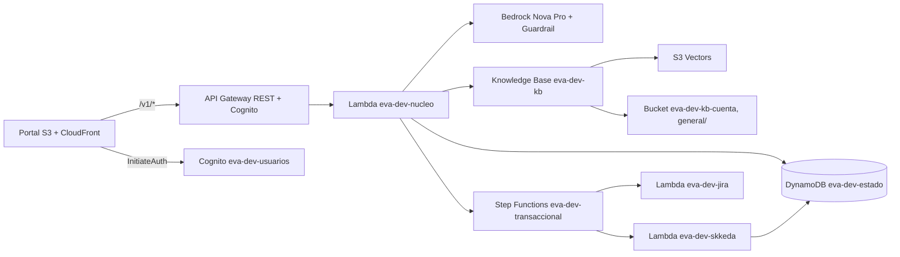

# Diseño

## Resumen

El stack `eva-dev` vive en un solo archivo, `infra/lib/eva-stack.ts`, que ya existe vacío y `infra/bin/app.ts` instancia. Los nombres se arman con `nombre(this.ambiente, '<recurso>')` (`infra/lib/nombres.ts`). El constructor se organiza en métodos privados, uno por grupo de recursos, que se llaman en el orden de las tareas. Así la tarea 1 deja un esqueleto desplegable y cada tarea siguiente agrega su método y las variables y permisos que le corresponden a la Lambda del núcleo.

Este diseño sigue el que ya se desplegó dos veces en la cuenta demo (lecciones 1 a 16 de `tecnologia.md`).

## Arquitectura

## Construcción por tareas

| Tarea | Método del stack | Qué deja en la Lambda del núcleo |
|---|---|---|
| 1. Esqueleto | `identidad()`, `tabla()`, `nucleo()`, `api()`, `portal()` | `TABLA_ESTADO`, `MODEL_ID`, `TITULOS_SECCION`, `INVESTIGACION_ACTIVA`; permiso de `tabla` |
| 2. Base de conocimiento | `baseConocimiento()` | `KB_ID`; `bedrock:Retrieve` |
| 3. Guardrail | `guardrail()` | `GUARDRAIL_ID`, `GUARDRAIL_VERSION`; `bedrock:ApplyGuardrail`, `bedrock:InvokeModel` sobre Nova Pro |
| 4. Conectores y flujo | `conectores()` | `FLUJO_TRANSACCIONAL_ARN`; `states:StartSyncExecution` |
| 5. Portal (lógica) | `src/portal/app.js` | no aplica |
| 6. Scripts y prueba de humo | `infra/scripts/*.mjs` | no aplica |

Cada método devuelve lo que el siguiente necesita (por ejemplo `baseConocimiento()` devuelve la `CfnKnowledgeBase`). Los métodos que agregan variables o permisos al núcleo usan `funcion.addEnvironment(...)` y `funcion.addToRolePolicy(...)`, para que el esqueleto no necesite valores inventados (R1.3).

Tu pedido fija solo las tareas 1 y 2. La división de las tareas 3 a 6 es una propuesta mía; se confirma en `tasks.md`.

## Componentes

| Recurso | Nombre | Claves |
|---|---|---|
| User Pool y cliente | `eva-dev-usuarios` | `selfSignUpEnabled: false`, cliente público con `authFlows: { userPassword: true }` y `generateSecret: false` |
| Usuario de prueba | `SYN-USR-0001` | `CfnUserPoolUser` con `messageAction: 'SUPPRESS'`; sin contraseña en la plantilla |
| Secreto | `eva/dev/usuario-prueba` | `secretsmanager.Secret` con `generateSecretString` (24 caracteres, `requireEachIncludedType: true`, sin puntuación problemática), cifrado con la llave administrada |
| Tabla | `eva-dev-estado` | `pk`/`sk` STRING, `PAY_PER_REQUEST`, `timeToLiveAttribute: 'ttl'`, cifrado `AWS_MANAGED` |
| Bucket KB | `eva-dev-kb-${this.account}` | `BLOCK_ALL`, `enforceSSL`, `S3_MANAGED`; `BucketDeployment` de `data/conocimiento/documentos/general` con `destinationKeyPrefix: 'general/'` |
| Vectores | `CfnVectorBucket` e índice | `CfnIndex` con `dataType: 'float32'`, `dimension: 1024`, `distanceMetric: 'cosine'`, `metadataConfiguration.nonFilterableMetadataKeys: ['AMAZON_BEDROCK_TEXT','AMAZON_BEDROCK_METADATA']` |
| Knowledge Base | `eva-dev-kb` | `CfnKnowledgeBase` tipo `VECTOR`, embeddings Titan v2, almacenamiento `S3_VECTORS`; `CfnDataSource` S3 con `inclusionPrefixes: ['general/']` |
| Guardrail | `eva-dev-guardrail` | Ver "Guardrail" |
| Lambdas | `eva-dev-nucleo`, `eva-dev-skkeda`, `eva-dev-jira` | `NodejsFunction`: Node 22, `ARM_64`, `bundling: { target: 'node22', externalModules: [] }`; el núcleo con timeout de 28 s; las otras dos, 10 s; `projectRoot` en la raíz |
| Máquina | `eva-dev-transaccional` | `StateMachineType.EXPRESS`; ver "Máquina" |
| API | `eva-dev-api` | `RestApi`, `CognitoUserPoolsAuthorizer`, recursos `v1/conversations` y `v1/conversations/{id}/confirm` con `POST` |
| Portal | bucket del sitio y `Distribution` | `S3BucketOrigin.withOriginAccessControl`; ver "Portal (infraestructura)" |

Todos los recursos llevan `RemovalPolicy.DESTROY` y los buckets `autoDeleteObjects: true`. Las Lambdas escriben en un `LogGroup` de una semana.

### Variables calculadas en la síntesis

- `TITULOS_SECCION`: función `titulosSeccion(carpeta)` que lee los `*.md` de `data/conocimiento/documentos/general`, toma las líneas `^##\s+(.+)$`, quita duplicados, ordena por longitud descendente y une con `|`. Si la carpeta no existe devuelve cadena vacía. La función se exporta desde un archivo propio (`infra/lib/titulos-seccion.ts`) para probarla sin sintetizar el stack.
- `INVESTIGACION_ACTIVA`: `'true'` solo si `tryGetContext('investigacion')` es `'true'` o `true`; en cualquier otro caso `'false'`.
- `MODEL_ID`: `amazon.nova-pro-v1:0`. `GUARDRAIL_VERSION`: `attrVersion` de la versión del guardrail.

## Permisos

| Rol | Permisos |
|---|---|
| Núcleo | `bedrock:InvokeModel` sobre `arn:aws:bedrock:<región>::foundation-model/amazon.nova-pro-v1:0`; `bedrock:Retrieve` sobre el ARN de la KB; `bedrock:ApplyGuardrail` sobre el ARN del guardrail y sobre `arn:aws:bedrock:*:<cuenta>:guardrail-profile/us.guardrail.v1:0`; `states:StartSyncExecution` sobre la máquina; `tabla.grantReadWriteData`. Nunca `lambda:InvokeFunction` |
| Skkeda | `tabla.grantReadWriteData` |
| Jira | Ninguno más que los registros que CDK agrega |
| Knowledge Base | `iam.Role` asumido por `bedrock.amazonaws.com`, con condiciones `aws:SourceAccount` y `aws:SourceArn`; `bedrock:InvokeModel` sobre Titan v2; `bucket.grantRead` limitado al prefijo `general/`; `s3vectors:PutVectors`, `GetVectors`, `DeleteVectors`, `QueryVectors` y `GetIndex` sobre el ARN del índice. `kb.node.addDependency(rol)` |
| Máquina | `lambda:InvokeFunction` sobre las dos Lambdas de conectores, lo que CDK concede a `LambdaInvoke` |

**Excepciones a "sin `*`" (R13.2):** el único comodín previsto es la región del ARN del perfil de guardrail (`guardrail-profile/us.guardrail.v1:0`), porque el perfil entre regiones se evalúa en las regiones de su grupo. Los permisos de registro de CloudWatch los concede CDK sobre el grupo de logs concreto.

Una prueba recorre todas las políticas de la plantilla y falla si encuentra `"Action": "*"`, o `"Resource": "*"` fuera de esa lista.

## Guardrail

`CfnGuardrail` con:

- `contentPolicyConfig.filtersConfig`: `PROMPT_ATTACK` HIGH en la entrada y NONE en la salida (el filtro no admite salida); `MISCONDUCT` LOW en la entrada y MEDIUM en la salida; `INSULTS` MEDIUM en ambas.
- `contentPolicyConfig.contentFiltersTierConfig: { tierName: 'STANDARD' }`, dentro de `contentPolicyConfig`.
- `crossRegionConfig.guardrailProfileArn`: `arn:aws:bedrock:<región>:<cuenta>:guardrail-profile/us.guardrail.v1:0`.
- `sensitiveInformationPolicyConfig.piiEntitiesConfig`: `CREDIT_DEBIT_CARD_NUMBER` y `PASSWORD` con `action: 'BLOCK'`.
- Sin `contextualGroundingPolicyConfig`.
- Mensajes de bloqueo de entrada y de salida en español.

`CfnGuardrailVersion` apunta al guardrail y lleva una `description` que se cambia en cada ajuste; la prueba verifica que exista y no esté vacía.

## Máquina `eva-dev-transaccional`

- `Choice` con `Condition.stringMatches('$.capabilityId', 'skkeda:*')` hacia un `LambdaInvoke` de Skkeda y `'jira:*'` hacia uno de Jira, ambos con `payloadResponseOnly: true` para que la salida sea el `InvokeResult` sin envoltura.
- `otherwise` va a un `Pass` que construye `{ correlationId, status: 'DENIED', origin: 'eva' }` con el `correlationId` de la entrada. Ninguna Lambda se invoca en esa rama.
- Registro en un `LogGroup` con nivel `ERROR` e `includeExecutionData: false`.
- Timeout de 25 s, por debajo de los 28 s de la Lambda del núcleo.

## Portal (infraestructura)

- Bucket privado con `BLOCK_ALL` y `enforceSSL`; origen por OAC; `defaultRootObject: 'index.html'`.
- `BucketDeployment` con `Source.asset('src/portal')` y `Source.jsonData('config.json', { region, userPoolId, userPoolClientId })`, con `distributionPaths: ['/*']`.
- Comportamiento adicional `v1/*`: `RestApiOrigin(api)`, `AllowedMethods.ALLOW_ALL`, `CachePolicy.CACHING_DISABLED` y una `OriginRequestPolicy.ALL_VIEWER_EXCEPT_HOST_HEADER`, que reenvía `Authorization` a la API (con el caché desactivado, esa política es la que lleva la cabecera). La prueba verifica ambas políticas en el comportamiento.
- `ResponseHeadersPolicy` con `Content-Security-Policy`: `default-src 'self'; img-src 'self' data:; style-src 'self'; script-src 'self'; connect-src 'self' https://cognito-idp.us-east-1.amazonaws.com; frame-ancestors 'none'`. Además HSTS de 365 días, `X-Content-Type-Options` y `X-Frame-Options: DENY`.
- Salidas: `PortalUrl` (`https://<dominio de CloudFront>`), `ApiUrl`, `UserPoolId`, `UserPoolClientId`, más `KbId` y `DataSourceId` desde la tarea 2.

## Portal (`src/portal/app.js`)

Sin dependencias y sin tocar los `id` de `index.html`. El estado vive en variables del módulo: `token`, `conversationId`.

- **Inicio:** `fetch('config.json')`.
- **Ingreso:** `fetch` a `https://cognito-idp.<region>.amazonaws.com/` con `Content-Type: application/x-amz-json-1.1`, `X-Amz-Target: AWSCognitoIdentityProviderService.InitiateAuth` y cuerpo `{ AuthFlow: 'USER_PASSWORD_AUTH', ClientId, AuthParameters: { USERNAME, PASSWORD } }`. Se guarda `AuthenticationResult.IdToken` solo en memoria. Si falla o llega un `ChallengeName`, `#error-ingreso` muestra "Usuario o contraseña incorrectos". Al ingresar se oculta `#vista-ingreso`, se muestra `#vista-chat` y se escribe el usuario en `#usuario-activo`.
- **Mensajes:** `POST /v1/conversations` con `Authorization: Bearer <token>`. El `conversationId` de la respuesta se reutiliza.
- **Dibujo de una respuesta:** se clona `#plantilla-mensaje` para EVA y se llena con `textContent`:
  - `.texto` con `reply`;
  - `.fuentes` con un `<li>` por cita: `título · sección · fecha` (sin sección, se omite);
  - `.pasos` (sin `hidden`) y `.lista-pasos` con un `<li>` por `researchSteps`: subpregunta, "encontrado" o "no encontrado" y los documentos;
  - `.accion` (sin `hidden`) y `.resumen` con un `<dt>` y un `<dd>` por clave de `summary`.
- **Burbujas de la persona:** mismo `<li class="mensaje">` con una clase de modificador `persona` y los elementos vacíos de la plantilla quitados. Se agregan al `#mensajes` y el contenedor se desplaza al final.
- **Confirmar o cancelar:** `POST /v1/conversations/{conversationId}/confirm` con `{ summaryHash, decision: 'CONFIRM' | 'CANCEL' }`. Se deshabilitan ambos botones al pulsar y no se vuelven a habilitar. La respuesta se dibuja como mensaje nuevo.
- **Errores:** `401` borra el token y vuelve al ingreso; cualquier otro error HTTP o de red muestra un mensaje de EVA con "No pude comunicarme con EVA. Intenta de nuevo.". `NEEDS_CLARIFICATION` y cualquier otro `status` se tratan igual que un mensaje normal.
- **Ocultar:** solo con el atributo `hidden`; `styles.css` debe tener `[hidden]{display:none !important}` (lección 10). Si falta, es un cambio de una línea que se avisa en vez de renombrar nada.
- **Sugerencias:** botones dentro de `#sugerencias` con los textos de las preguntas 1 a 7 de `producto.md`. La 7 se cubre con cuatro botones: "Hola", "Hola, ayúdame a reservar un puesto en el piso 3", "Ayúdame a buscar el archivo de gestión de cambios" y "Ayúdame a buscar mis tareas abiertas en Jira". Pulsar uno lo escribe y lo envía.
- **Pruebas:** como el portal no tiene dependencias, la lógica pura (dibujar una respuesta, armar la lista de fuentes) se prueba con Jest y el entorno `jsdom` solo si ya está disponible en el repositorio. Si no lo está, se prueba contra lo desplegado con la prueba de humo y se avisa, en vez de agregar dependencias.

## Scripts (`infra/scripts/*.mjs`)

Solo Node 22 y AWS CLI (`execFileSync('aws', [...])`, sin shell). Por defecto usan el stack `eva-dev`; la variable `STACK` lo cambia.

- **Salidas del stack:** `aws cloudformation describe-stacks`.
- **Contraseña:** `aws secretsmanager get-secret-value --secret-id eva/dev/usuario-prueba --query SecretString --output text`. Se guarda en una variable, nunca se imprime y los mensajes de error no la incluyen.
- **`usuario-prueba.mjs`:** `aws cognito-idp admin-set-user-password --permanent` con el User Pool y el usuario `SYN-USR-0001`. La contraseña se pasa por la línea de comandos solo dentro de `execFileSync`, sin eco; se documenta que en Windows queda visible solo en la lista de procesos local durante la llamada.
- **`ingestar.mjs`:** usa `@aws-sdk/client-bedrock-agent` (ya en `package.json`). `StartIngestionJob`, consulta de `GetIngestionJob` cada 5 s con límite de 10 minutos, muestra `statistics.numberOfNewDocumentsIndexed` y las demás cifras. Si el estado es `FAILED` o se agota el tiempo, muestra `failureReasons` y sale con código 1.
- **`prueba-humo.mjs`:** inicia sesión con `InitiateAuth` por `fetch`, y recorre la demo con un `conversationId` por escenario:
  1. preguntas 1 y 2 (la 2 en la misma conversación);
  2. 3, 4 y 5, cada una en conversación nueva;
  3. 6, con confirmación;
  4. 7: "Hola"; "Hola, ayúdame a reservar un puesto en el piso 3", "El jueves" y confirmar; "Ayúdame a buscar el archivo de gestión de cambios"; "Ayúdame a buscar mis tareas abiertas en Jira".

  Por cada paso imprime `status`, los `title` de las citas y las claves y valores de `pendingAction.summary`. Con `--investigacion` agrega las preguntas 8 y 9 (la 9 con su respuesta "internacional" en la misma conversación) e imprime los `researchSteps` (subpregunta, encontrado, documentos). No imprime tokens ni contraseñas. No define resultados esperados ni comprueba errores: el R12 pide solo mostrar.

  Las reservas que crea quedan en la tabla; por el TTL y la regla de un puesto por día, repetir la prueba el mismo día puede devolver `DAILY_LIMIT`. Se documenta, sin agregar limpieza que el requisito no pide.

## Manejo de errores y operación

- Si falta `data/conocimiento/documentos/general` falla `BucketDeployment` durante la síntesis de la tarea 2. El esqueleto de la tarea 1 no depende del corpus, salvo `TITULOS_SECCION`, que devuelve cadena vacía.
- La ingesta no es automática: tras cada despliegue que cambie el corpus se ejecuta `ingestar.mjs`.
- **Credenciales SSO (lección 1):** antes de `cdk deploy` se exportan con `aws configure export-credentials --profile <perfil> --format process` y se fijan `CDK_DEFAULT_ACCOUNT` y `CDK_DEFAULT_REGION`. Eso lo hace la operadora.
- El orden de despliegue es: tarea 1, `usuario-prueba.mjs`; tarea 2, `ingestar.mjs`; resto, `prueba-humo.mjs`.

## Pruebas

- Un archivo `infra/lib/eva-stack.test.ts` que crece con cada tarea, usando `Template.fromStack` y un `App` con el contexto `aws:cdk:bundling-stacks: []` para no empaquetar con esbuild.
- Pruebas por requisito: Cognito (sin auto registro, flujo, usuario con `SUPPRESS`, ninguna contraseña en la plantilla), tabla, bucket y `BucketDeployment` solo de `general/`, índice de vectores, rol de la KB, fuente de datos, guardrail (nivel, filtros, ausencia de grounding, versión con `description`), máquina (ramas y `DENIED`, `includeExecutionData: false`), permisos del núcleo (lista exacta de acciones, sin `lambda:InvokeFunction`), API (autorizador en ambas rutas), distribución (comportamiento `v1/*`, CSP, OAC) y `config.json`.
- `infra/lib/titulos-seccion.test.ts` para el cálculo de `TITULOS_SECCION` y la lectura de `investigacion`.
- Cada prueba debe fallar si se quita la propiedad que verifica.
