# 04 — Flujos principales

Todos los flujos comparten el mismo `correlationId` y pasan por el Policy Engine antes de cualquier consulta o ejecución.

## 4.1 Consulta de conocimiento híbrida (CU1, CU4)

Contenido propio y general desde el índice; contenido restringido de Daruma en vivo con la identidad del colaborador.

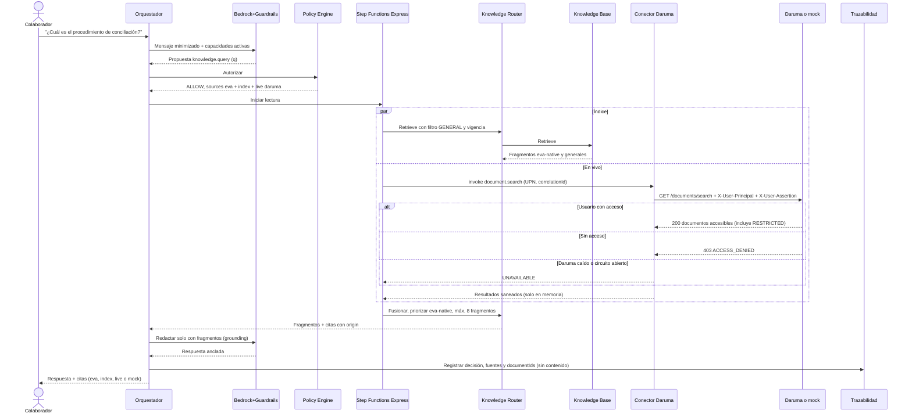

Reglas de la ruta de denegación: con `403` no se revela título, fragmento ni existencia (RF-15.3); con Daruma no disponible se responde con lo indexado y se avisa (RF-15.5).

### Seguimiento de un `correlationId` (c-7f3a9d)

| # | Evento (`EVT#<ts>#<type>`) | Datos registrados |
|---|----------------------------|-------------------|
| 1 | `IDENTITY_RESOLVED` | userIdHash, grupos |
| 2 | `INTENT_PROPOSED` | `knowledge.query`, confidence |
| 3 | `POLICY_DECISION` | ALLOW, sources, policyVersion |
| 4 | `KNOWLEDGE_RETRIEVED` | n.º fragmentos por origen, knowledgeIds |
| 5 | `CONNECTOR_INVOKED` | daruma, `document.search`, REST_DIRECT, origin `mock`, 403 o 200, documentIds |
| 6 | `ANSWER_DELIVERED` | citas (ids), grounding score |

Ningún evento guarda texto de documentos restringidos, tokens ni aserciones.

## 4.2 Patrón de escritura con confirmación (CU2, CU3)

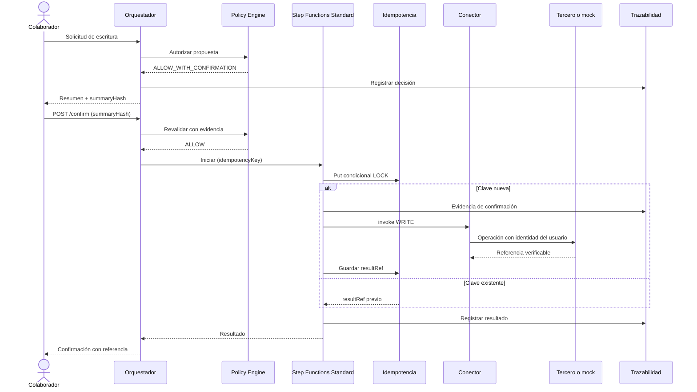

## 4.3 CU2 — Reserva en Skkeda con conflicto y ruta física (RF-18)

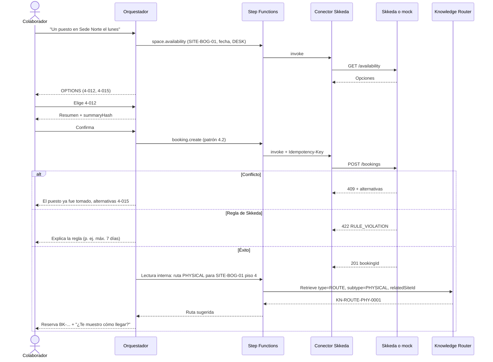

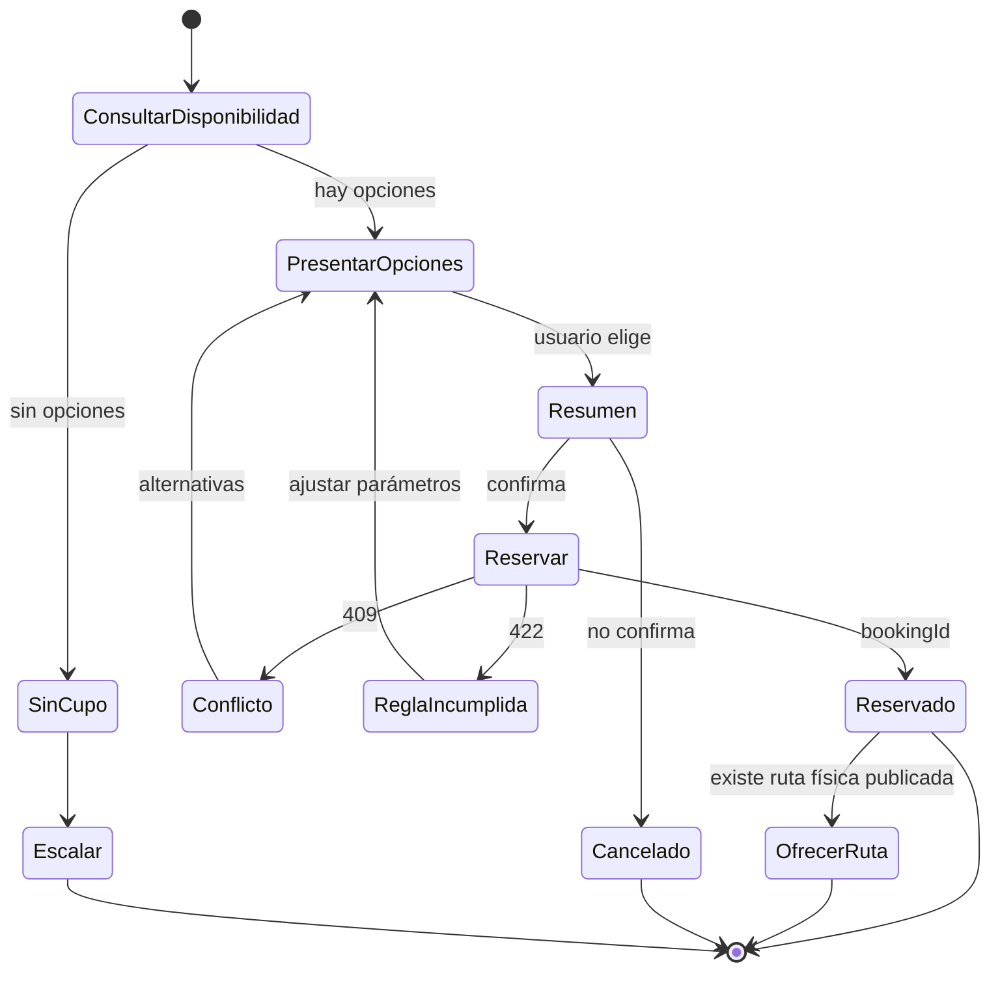

## 4.4 CU3 — Jira con consentimiento, lectura y escritura (RF-19)

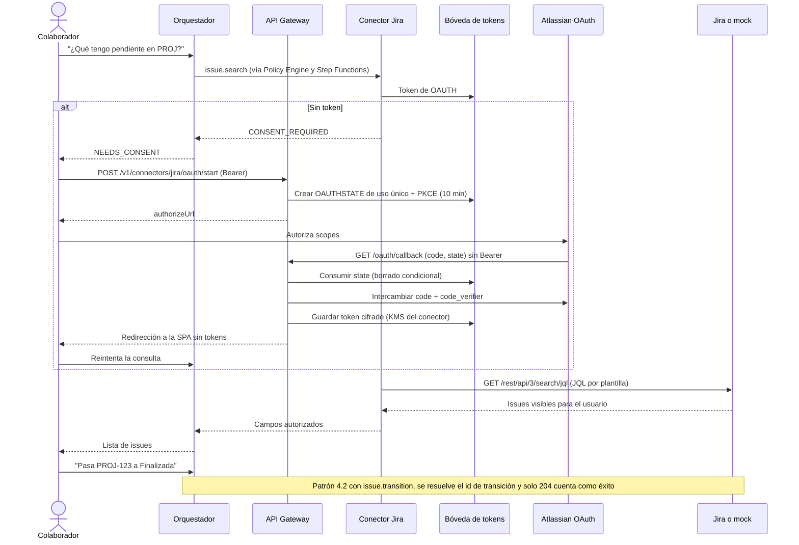

## 4.5 Ingesta programada (RF-13)

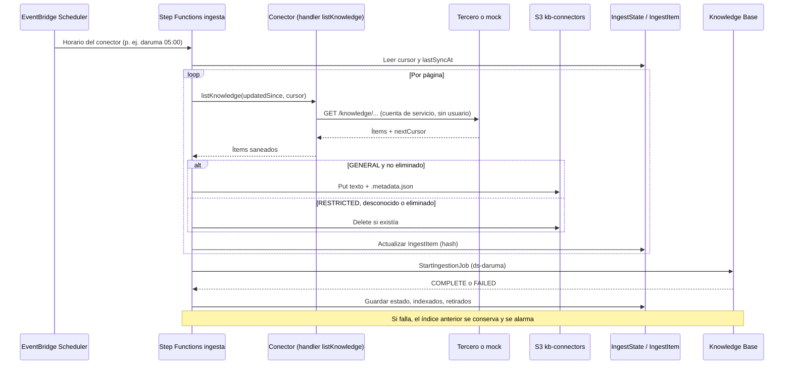

## 4.6 Publicación y vencimiento de contenido propio (RF-16)

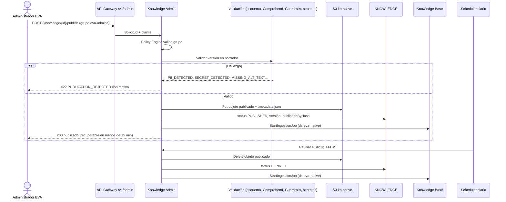

## 4.7 Alta de un conector (RF-12)

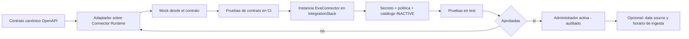

Ningún paso modifica orquestador, Policy Engine ni flujos (RNF-13).

## 4.8 Invocación MCP o A2A (preparada, Roadmap)

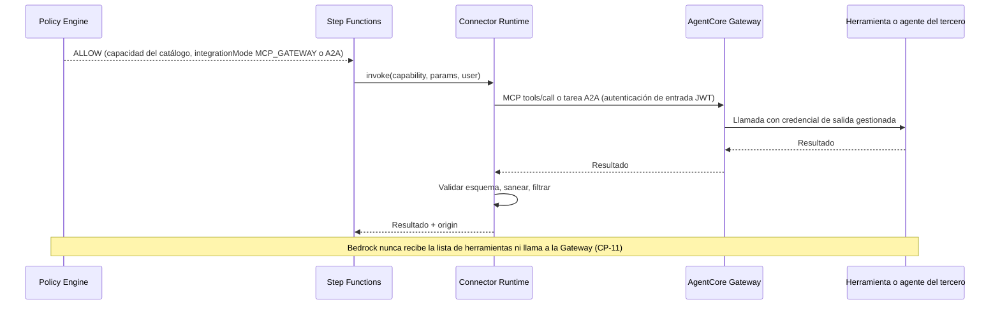

## 4.9 Máquina de estados transaccional (Step Functions)

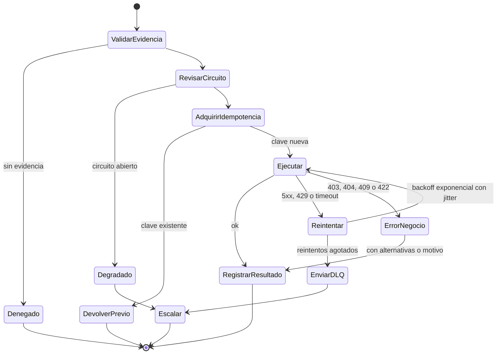

## 4.10 Escalamiento humano (RF-22)

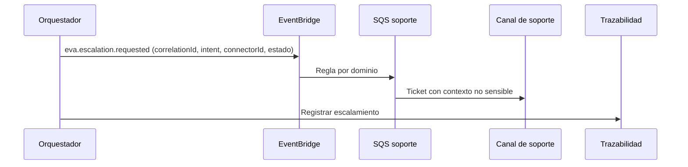
