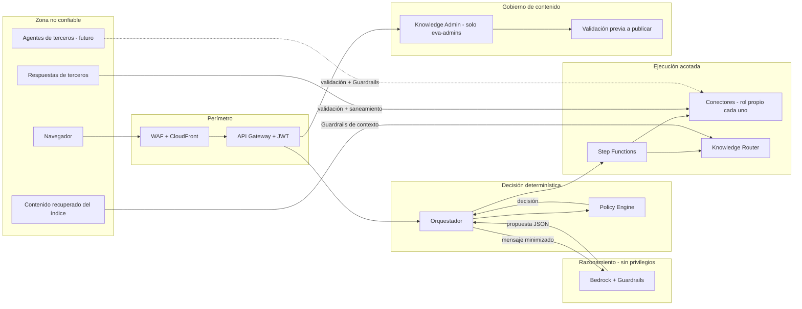

# 06 — Arquitectura de seguridad

Security by Design, Zero Trust y mínimo privilegio. Reglas centrales: ninguna salida del modelo llega a un conector sin el Policy Engine (CP-01, CP-11) y ningún contenido restringido entra al índice (CP-10).

## Zonas de confianza

## Controles por requisito

| Req | Control arquitectónico |
|-----|------------------------|
| RS-01 | Bedrock sin herramientas, credenciales ni URLs; solo JSON de propuesta y redacción con fragmentos ya autorizados |
| RS-02 | Policy Engine valida identidad, grupos, parámetros, conector `ACTIVE`, capacidad y riesgo; decide fuentes de conocimiento |
| RS-03 | `summaryHash` revalidado; evidencia en DynamoDB y S3 Object Lock |
| RS-04 | Un rol IAM, secreto y llave KMS por conector; handler de ingesta con rol separado |
| RS-05 | Validación contra el contrato, límites de tamaño, saneamiento y filtro de campos en el Connector Runtime |
| RS-06 | Guardrails de entrada/salida + validación de capacidad contra catálogo; JQL por plantilla, nunca libre |
| RS-07 | Secretos solo en Secrets Manager; redacción de campos sensibles en logs |
| RS-08 | Minimización del prompt y filtros de PII |
| RS-09 | UPN del token en cada llamada; aserción firmada por usuario; token OAuth por usuario; Daruma y Jira aplican sus permisos |
| RS-10 | Credenciales de conectores en Secrets Manager con rotación |
| RS-11 | TLS 1.2+; KMS en S3, DynamoDB, SQS, índice vectorial, logs y secretos |
| RS-12 | CloudTrail multi-región con validación de integridad; eventos de auditoría para catálogo y contenido propio |
| RS-13 | WAF con reglas administradas y rate limiting |
| RS-14 | JWT validado en cada solicitud; ningún componente confía en la red |
| RS-15 | Guardrails sobre el contexto recuperado (ataques de prompt) y verificación de anclaje en la salida |
| RS-16 | **Por diseño:** ingesta con denegación por defecto (solo `GENERAL` exacto) + filtro `classification = GENERAL` obligatorio en `Retrieve` + retiro en la siguiente sincronización; Daruma restringido solo en vivo y en memoria |
| RS-17 | **Por diseño:** `MocksStack` solo se instancia en dev/test; `allowMockScenarios=false` en prod; aserción CDK y regla de pipeline que fallan si la plantilla o el catálogo de prod contienen `eva:mock=true` o URLs de mock |
| RS-18 | Tokens, credenciales y aserciones solo dentro del conector; nunca en payloads a Bedrock, respuestas de API ni logs |
| RS-19 | **Por diseño:** `classification` fijo en `GENERAL` en el esquema; validación previa con Comprehend, Guardrails y patrones de secretos; publicación solo por `eva-admins` |

## Identidad y autenticación hacia terceros

| Mecanismo | Detalle |
|-----------|---------|
| Usuario → EVA | Cognito federado con Directorio Activo; token de acceso de 15 min; grupo `eva-admins` mapeado desde un grupo del Directorio Activo |
| EVA → Daruma/Skkeda | Cuenta de servicio (Secrets Manager) + `X-User-Principal` + `X-User-Assertion` (JWT de 60 s firmado con la llave KMS asimétrica `eva-<env>-user-assertion`, `aud` por conector, `jti` único). JWKS publicado para que el tercero valide |
| EVA → Jira | OAuth 2.0 3LO del colaborador; `state` ligado a la sesión; tokens cifrados con la llave del conector Jira |
| EVA → futuros con Entra ID | On-Behalf-Of (requiere federación Entra ID) |

## Roles IAM (mínimo privilegio)

| Rol | Permisos permitidos |
|-----|---------------------|
| `eva-orchestrator` | `bedrock:InvokeModel` sobre modelos aprobados, `bedrock:ApplyGuardrail`, invocar Policy Engine, `states:StartExecution`/`StartSyncExecution` sobre flujos de EVA, lectura/escritura `CONV#*` (incluye `PENDING` y `TURN#`), `events:PutEvents` |
| `eva-policy-engine` | Lectura de `CONNECTOR#*` y `POLICY#*` |
| `eva-sfn-read` | Invocar handlers `invoke` de conectores y `eva-knowledge-router`; escritura `CONV#*` |
| `eva-sfn-transactional` | Invocar handlers `invoke` de conectores, escritura `IDEMP#*`, `CONV#*`, lectura/escritura `CB#*`, `sqs:SendMessage` a la DLQ |
| `eva-connector-daruma` | `secretsmanager:GetSecretValue` sobre `eva/<env>/daruma/*`, `kms:Sign` sobre `eva-<env>-user-assertion`, lectura/escritura `CB#daruma` |
| `eva-connector-skkeda` | Secretos `eva/<env>/skkeda/*`, `kms:Sign` sobre la llave de aserción, `CB#skkeda` |
| `eva-connector-jira` | Secretos `eva/<env>/jira/*`, `kms:Encrypt`/`Decrypt` con la llave del conector Jira, lectura/escritura `OAUTH#jira#*`, `CB#jira` |
| `eva-connector-<id>-ingest` | Secreto de ingesta del conector (alcance solo lectura de contenido general); sin `kms:Sign` (no actúa en nombre de usuarios) |
| `eva-ingestion` | Invocar handlers `listKnowledge`, escribir/borrar en `kb-connectors/*`, `INGEST#*`, `bedrock:StartIngestionJob` sobre `ds-<connectorId>` |
| `eva-knowledge-router` | `bedrock:Retrieve` sobre `eva-<env>-kb`, `bedrock:ApplyGuardrail` |
| `eva-knowledge-admin` | Invocar Policy Engine, lectura/escritura `kb-native/*`, `KNOWLEDGE#*`, `comprehend:DetectPiiEntities`, `bedrock:ApplyGuardrail`, `bedrock:StartIngestionJob` sobre `ds-eva-native`; lectura de `published/` para `GET /v1/knowledge/{id}` |
| `eva-catalog-admin` | Invocar Policy Engine, escritura `CONNECTOR#*`, `POLICY#*`; `states:StartExecution` sobre `eva-<env>-ingestion` para sincronización bajo demanda |
| `eva-oauth` | Lectura/escritura `OAUTHSTATE#*`; `kms:Encrypt` con la llave del conector Jira y escritura `OAUTH#jira#*`; secreto `eva/<env>/jira/oauth-client` |
| `eva-mocks` (solo dev/test) | Lectura/escritura `eva-<env>-mocks` |

Ningún conector puede invocar Bedrock, otro conector ni la Knowledge Base. Ningún rol fuera de `eva-orchestrator` invoca modelos de generación.

## Registros que podrían filtrar contenido restringido

El contenido restringido de Daruma pasa en memoria por Step Functions, el orquestador y Bedrock. Para cumplir RF-15.4 y RS-16, ningún mecanismo de registro puede persistirlo:

| Mecanismo | Configuración obligatoria |
|-----------|---------------------------|
| Bedrock model invocation logging | **Desactivado** en las cuentas de EVA, o con entrega de texto excluida; verificado por AWS Config o prueba de aserción |
| Step Functions `eva-<env>-read` (Express) | Logging con `includeExecutionData = false` |
| Step Functions Standard | Solo transporta referencias y parámetros de escritura; nunca fragmentos de conocimiento |
| Lambda (orquestador, Daruma, Router) | Logs estructurados sin cuerpos de respuesta; redacción de `snippet`, `summary` y `text` |
| X-Ray | Solo anotaciones (`correlationId`, `connectorId`); sin metadatos con contenido |
| Historial `Turn` | Solo `citationIds` en respuestas de conocimiento |

## Red

- Conectores fuera de VPC por defecto (SaaS sobre TLS 1.2+).
- Si un tercero exige lista de IP: subred privada con NAT e IP elástica fija para ese conector.
- Si un tercero es on-premise: Site-to-Site VPN o Direct Connect. Decisión por conector en el catálogo.

## Amenazas principales (STRIDE resumido)

| Amenaza | Ejemplo | Mitigación |
|---------|---------|------------|
| Spoofing | Token robado; uso de la cuenta de servicio para suplantar a otro usuario | JWT de vida corta; aserción firmada por KMS con `aud` y `jti`; rotación de secretos; alcance mínimo de la cuenta de servicio |
| Tampering | Cambiar parámetros entre resumen y confirmación | `summaryHash` revalidado por el Policy Engine |
| Repudiation | "Yo no confirmé" o "yo no publiqué ese contenido" | Evidencia inmutable; auditoría de publicación con `publishedByHash` y CloudTrail |
| Information disclosure | Fuga de contenido restringido de Daruma vía índice, trazas o respuesta a otro usuario | Restringido nunca indexado (RS-16), solo en memoria, identidad del solicitante en cada llamada (RS-09) |
| Information disclosure | Reclasificación de un documento de general a restringido | Retiro en la siguiente sincronización; ventana acotada por `maxAgeHours` (RNF-14); prueba `stale_classification` |
| Denial of service | Inundación de mensajes o tercero lento | WAF, throttling, concurrencia reservada, timeouts y cortocircuito por conector |
| Elevation of privilege | Prompt injection directa pidiendo una capacidad no permitida | Guardrails + catálogo + Policy Engine |
| Elevation of privilege | Prompt injection **indirecta**: instrucciones sembradas en un documento indexado o en la respuesta de un tercero | Contexto recuperado tratado como no confiable, Guardrails de contexto, el modelo no tiene herramientas, toda acción pasa por el Policy Engine |
| Tampering | **Publicación maliciosa** de contenido propio (enlace de phishing, instrucciones engañosas) | Solo `eva-admins`, validación previa, versionado, auditoría y retiro inmediato |
| Information disclosure | Mock desplegado en prod con datos o escenarios de prueba | RS-17: stack condicionado, flag por ambiente y bloqueo en pipeline |
| Information disclosure | Contenido restringido persistido por logs de invocación de Bedrock o historial de Step Functions | Invocation logging desactivado, `includeExecutionData = false`, redacción en Lambdas (ver tabla de registros) |
| Spoofing | CSRF o reutilización en el callback OAuth para ligar el Jira de un atacante a otro usuario | `state` aleatorio de uso único ligado a `userIdHash`, TTL 10 min, PKCE, redirect URI fija |
| Tampering | Confirmar una acción distinta a la propuesta o elegir una opción no ofrecida | `PENDING` con `summaryHash` y `options[]`; validación contra lo guardado |
