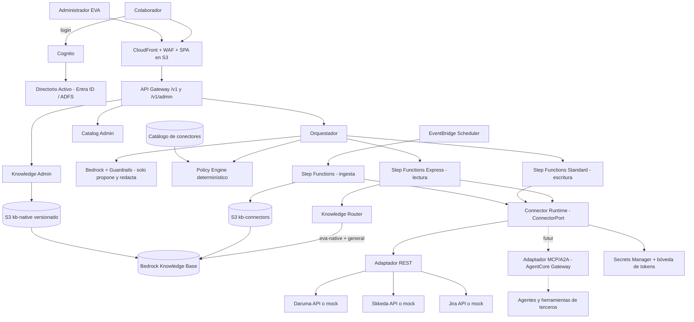
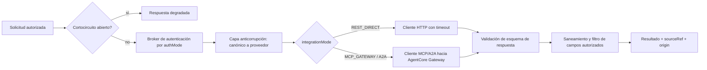
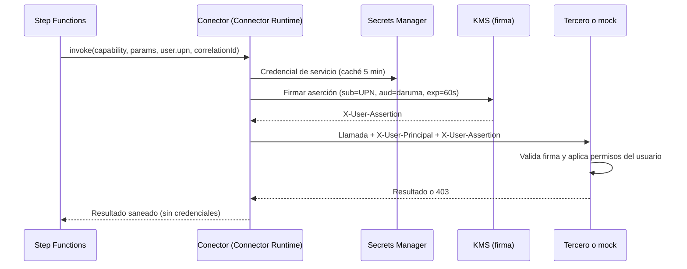
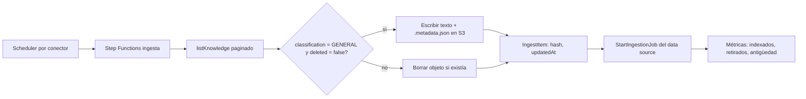
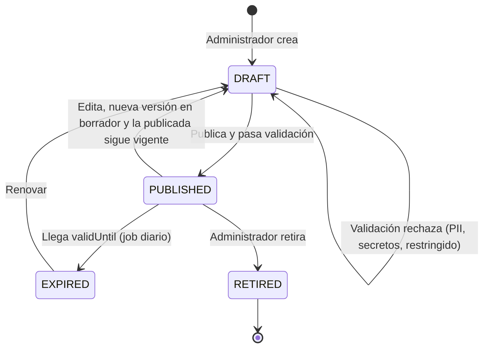

# design

> **Documento 2 de 3** del Spec `eva-enterprise-virtual-assistant` (v2.0).
> Flujo Spec-Driven Development (Kiro): **Requirements → Design → Tasks**.
> Define **cómo se construye** EVA como hub de integración con terceros (Daruma, Skkeda, Jira) y base de conocimiento unificada. Deriva de `requirements.md` y alimenta `tasks.md`. La arquitectura detallada vive en [`docs/arquitectura/`](../arquitectura/) y los contratos en [`contratos/`](../arquitectura/contratos/).

---

## Overview

EVA es el punto único de interacción conversacional de los colaboradores de Redeban sobre las aplicaciones corporativas de terceros. No reimplementa procesos: los **centraliza** mediante **conectores** gobernados por un catálogo y ofrece una **base de conocimiento unificada**.

- Un colaborador autenticado con el **Directorio Activo** conversa en lenguaje natural.
- **Amazon Bedrock** interpreta la intención y **propone** una capacidad o una consulta de conocimiento; nunca autoriza ni ejecuta.
- El **Policy Engine** determinístico decide `ALLOW`, `DENY` o `ALLOW_WITH_CONFIRMATION` y, para preguntas, qué fuentes se pueden usar.
- La capa de ejecución invoca el **conector** a través de la interfaz común `ConnectorPort`: REST directo hoy, MCP/A2A preparado.
- El conocimiento combina contenido **propio de EVA**, contenido **general** indexado de los conectores y contenido **restringido de Daruma consultado en vivo** con la identidad del usuario.
- Los terceros son la **autoridad del dato**. Las escrituras exigen **confirmación** y son **idempotentes**. Todo se **traza** con `correlationId`.

## Architecture

Capas desacopladas sobre servicios AWS administrados (detalle en §3):

- **Edge:** S3 + CloudFront + WAF.
- **Identidad:** Cognito federado con el Directorio Activo (Entra ID OIDC o ADFS SAML).
- **API:** API Gateway `/v1` (colaborador) y `/v1/admin` (administradores).
- **Razonamiento:** Bedrock + Guardrails (propuestas y generación anclada al contenido recuperado).
- **Autorización:** Policy Engine determinístico.
- **Orquestación:** Orquestador + Step Functions (lectura, escritura, ingesta).
- **Integración:** Connector Runtime, adaptadores REST y MCP/A2A, conectores Daruma, Skkeda, Jira.
- **Conocimiento:** Knowledge Router, Bedrock Knowledge Bases, ingesta, contenido propio `eva-native`.
- **Mocks:** solo dev/test.
- **Estado, seguridad y observabilidad:** DynamoDB, SQS/DLQ, EventBridge, Secrets Manager, KMS, CloudWatch, X-Ray, CloudTrail.

## Components and Interfaces

Componentes en §4 a §7. Interfaces públicas (detalle en §14):

| Método | Ruta | Propósito |
|--------|------|-----------|
| POST | `/v1/conversations` | Mensaje en lenguaje natural; devuelve aclaración, opciones, resumen, respuesta con citas o resultado. |
| POST | `/v1/conversations/{id}/confirm` | Confirmar o rechazar una escritura. |
| GET | `/v1/conversations/{id}` | Estado y eventos de la propia interacción. |
| POST | `/v1/escalations` | Escalar a soporte. |
| GET | `/v1/knowledge/{knowledgeId}` | Ver un ítem publicado de `eva-native` citado en una respuesta. |
| POST · GET | `/v1/connectors/{connectorId}/oauth/start` · `/callback` | Consentimiento OAuth del colaborador (Jira); el callback es público y se valida con `state` + PKCE. |
| * | `/v1/admin/connectors…` | Catálogo de conectores (solo administradores, auditado). |
| * | `/v1/admin/knowledge…` | Contenido propio (solo administradores, auditado). |

Interfaz interna estable: `ConnectorPort` (§5.2).

## Data Models

DynamoDB single-table (§10): `ConnectorCatalog`, `Policy`, `Conversation`, `PendingAction`, `Turn`, `TraceEvent`, `ConfirmationEvidence`, `Idempotency`, `IngestState`, `IngestItem`, `KnowledgeItem`, `OAuthToken`, `OAuthState`, `CircuitState`. Índice vectorial en Bedrock Knowledge Bases con metadatos de filtrado. EVA no almacena datos de negocio de terceros ni contenido restringido.

---

## 1. Resumen de la solución

EVA resuelve la fragmentación entre aplicaciones de terceros: el colaborador pregunta o pide una acción y EVA sabe a qué aplicación ir, con qué identidad y con qué controles.

### 1.1 Objetivos de diseño y su origen

| Objetivo | Requisitos |
|----------|------------|
| Separar razonamiento, autorización y ejecución | RF-07, RF-08, RS-01, RS-02 |
| Integrar terceros heterogéneos con una interfaz estable | RF-10, RF-12, RNF-13, RNF-15 |
| Autenticar ante cada tercero sin debilitar la identidad del usuario | RF-11, RS-09, RS-18 |
| Conocimiento unificado sin fuga de contenido restringido | RF-13..RF-15, RS-15, RS-16 |
| Conocimiento propio gobernado | RF-16, RS-19 |
| Confirmación e idempotencia en escrituras | RF-09, RNF-06, RS-03 |
| Probar sin proveedores | RF-24, RS-17 |
| Trazabilidad y observabilidad por conector | RF-20, RF-23, RNF-07 |
| IaC y ambientes separados | RNF-08, RNF-10 |

---

## 2. Principios y decisiones de arquitectura (ADR resumidos)

Detalle en [`adr/README.md`](../arquitectura/adr/README.md).

| ADR | Decisión | Estado |
|-----|----------|--------|
| ADR-01 | Servicios AWS administrados serverless | Aceptada |
| ADR-02 | Separación IA / políticas / ejecución | Aceptada |
| ADR-03 | Step Functions para flujos transaccionales | Aceptada |
| ADR-04 | Un rol IAM por conector | Aceptada |
| ADR-05 | Guardrails (entrada, contexto, salida) + validación contra catálogo | Aceptada |
| ADR-06 | Mocks con el contrato real | Reemplazada por ADR-13/ADR-14 |
| ADR-07 | IaC con AWS CDK (TypeScript) | Aceptada |
| ADR-08 | DynamoDB single-table con TTL | Aceptada |
| ADR-09 | Capa de conectores híbrida con `ConnectorPort` | Aceptada |
| ADR-10 | Base de conocimiento híbrida por clasificación | Aceptada |
| ADR-11 | Autenticación declarada por conector | Aceptada |
| ADR-12 | AgentCore Gateway como adaptador MCP/A2A sin invocación desde la IA | Aceptada (preparada) |
| ADR-13 | Contratos canónicos + capa anticorrupción | Aceptada |
| ADR-14 | Mocks desde OpenAPI con escenarios, prohibidos en prod | Aceptada |
| ADR-15 | Contenido propio curado por administradores | Aceptada |

---

## 3. Arquitectura de referencia

### 3.1 Diagrama de alto nivel



### 3.2 Vista lógica por capas

| Capa | Responsabilidad | Servicios AWS | Requisitos |
|------|-----------------|---------------|------------|
| Edge | SPA y protección perimetral | S3, CloudFront, WAF | RNF-01, RS-13 |
| Identidad | Federación con Directorio Activo, token de vida corta | Cognito | RF-01, RF-02, RS-14 |
| API | Contratos `/v1` y `/v1/admin`, JWT, throttling | API Gateway | RF-02, RNF-09 |
| Razonamiento | Intención, parámetros y redacción anclada | Bedrock, Guardrails | RF-03..RF-05, RF-14, RS-06, RS-15 |
| Autorización | Decisión determinística y fuentes permitidas | Lambda Policy Engine | RF-08, RS-01, RS-02 |
| Orquestación | Enrutamiento y flujos | Lambda, Step Functions | RF-07, RF-09 |
| Integración | `ConnectorPort`, adaptadores, autenticación por conector | Lambda por conector, Secrets Manager, KMS, AgentCore Gateway (preparado) | RF-10..RF-12, RS-04, RS-05 |
| Conocimiento | Ingesta, índice, recuperación, contenido propio | Bedrock Knowledge Bases, S3 Vectors, S3, Comprehend | RF-13..RF-16, RS-16, RS-19 |
| Mocks | Terceros simulados (dev/test) | API Gateway, Lambda, DynamoDB | RF-24, RS-17 |
| Estado | Catálogo, políticas, idempotencia, trazas, ingesta | DynamoDB, SQS, DLQ, EventBridge | RF-06, RF-20, RNF-06 |
| Seguridad | Secretos, cifrado, firma, auditoría | Secrets Manager, KMS, CloudTrail | RS-07, RS-10..RS-12 |
| Observabilidad | Logs, métricas, trazas, alarmas | CloudWatch, X-Ray | RF-23, RNF-07 |

---

## 4. Núcleo

### 4.1 Frontend web
- SPA responsiva (RNF-01) y accesible (RNF-02) en S3 + CloudFront + WAF (RS-13).
- Login OIDC con Cognito federado al Directorio Activo; token en memoria, nunca en `localStorage`.
- Muestra citas con su origen (`eva`, `index`, `live`, `mock`), opciones seleccionables (puestos, issues) y rutas físicas con texto alternativo.
- Vista de administración visible solo para el grupo `eva-admins` (la API vuelve a validar).
- **Cubre:** RF-01, RF-03, RF-14.2, RF-24.5, RNF-01, RNF-02.

### 4.2 Orquestador (Lambda)
- Extrae `userId` (UPN) y grupos de los claims; nunca del mensaje (RF-02.4).
- Genera `correlationId` y lo propaga (RF-20).
- Invoca NLU con payload mínimo; envía la propuesta al Policy Engine; inicia el flujo de lectura o devuelve el resumen de escritura.
- Para preguntas, recibe del Knowledge Router los fragmentos autorizados y pide a Bedrock la respuesta con Guardrails y verificación de anclaje (RF-14.3).
- Nunca invoca conectores directamente (CP-01, CP-11).
- **Cubre:** RF-02, RF-03, RF-07.

### 4.3 NLU (Bedrock + Guardrails)
- Salida JSON validada contra esquema: `intent`, `confidence`, `proposedCapability` (`<connectorId>:<capability>` o `knowledge.query`), `parameters`.
- El catálogo expuesto al modelo es solo la lista de capacidades activas (nombre, descripción, esquema). Sin URLs, secretos, tokens ni herramientas ejecutables (RS-01, RS-18).
- Confianza bajo umbral → aclaración (RF-04.3).
- Guardrails: temas denegados, ataques de prompt, PII en entrada y salida (RS-06, RS-08).
- **Cubre:** RF-04, RF-05, RNF-11.

### 4.4 Policy Engine (Lambda determinístico)
Función pura sobre `(identidad, grupos, capacidad propuesta, parámetros, versión de catálogo y política)`:

| Resultado | Condición |
|-----------|-----------|
| `DENY` | Falla identidad, permiso de dominio, esquema, conector inactivo, capacidad no declarada o riesgo no admitido |
| `ALLOW` | Lectura válida. Para `knowledge.query` incluye `sources` permitidas |
| `ALLOW_WITH_CONFIRMATION` | Escritura válida; exige `summaryHash` confirmado |

Ejemplo de decisión de conocimiento:

```json
{ "decision": "ALLOW", "capability": "knowledge.query",
  "sources": { "eva": true, "index": ["daruma", "skkeda"], "live": ["daruma:document.search"] },
  "policyVersion": "POLICY#knowledge/V#3" }
```

- Las capacidades de administración exigen el grupo `eva-admins` (RF-16.2).
- Sin llamadas a modelos (RF-08.5). Misma entrada, misma decisión (CP-02).
- **Cubre:** RF-08, RF-09, RS-01, RS-02, RS-09.

### 4.5 Flujos (Step Functions)
- **Lectura (Express) `eva-<env>-read`:** invoca conector o Knowledge Router; para preguntas ejecuta en paralelo recuperación del índice y consulta en vivo autorizada; timeouts por rama.
- **Escritura (Standard) `eva-<env>-transactional`:** `ValidarEvidencia → AdquirirIdempotencia → Ejecutar → RegistrarResultado`, con reintentos con backoff solo en errores transitorios, DLQ y escalamiento (ver [`04-flujos.md`](../arquitectura/04-flujos.md)).
- **Ingesta (Standard) `eva-<env>-ingestion`:** §6.2.
- **Cortocircuito por conector:** el estado `CB#<connectorId>` se consulta antes de invocar; abierto → respuesta degradada inmediata (RF-21.5).
- `idempotencyKey = sha256(userId + pendingActionId + summaryHash)`. `pendingActionId` es único por acción propuesta: los reintentos de la misma confirmación se deduplican, y una nueva propuesta idéntica (p. ej. reservar de nuevo tras cancelar) obtiene clave nueva.
- **Estado conversacional:** la acción pendiente (`PENDING`) y las opciones presentadas se guardan para validar `/confirm` y la elección; el historial (`TURN#`) guarda mensajes minimizados y, en respuestas de conocimiento, solo identificadores de citas, nunca texto restringido (RF-15.4).
- **Cubre:** RF-07, RF-09, RF-21, RNF-05, RNF-06.

### 4.6 Trazabilidad
- `TraceEvent` por paso con `correlationId`, `userIdHash`, conector, capacidad, `integrationMode`, `origin`, decisión y referencia de resultado (RF-20.2).
- Contenido restringido nunca se registra: solo `documentId` (RF-15.4).
- Sin secretos, tokens ni aserciones (RS-07, RS-18).
- **Cubre:** RF-20, RNF-07, RS-07, RS-08.

### 4.7 Escalamiento humano
Evento `eva.escalation.requested` en EventBridge con `correlationId`, intención, conector, parámetros no sensibles y estado; regla por dominio hacia el canal de soporte (RF-22).

---

## 5. Integración con terceros

### 5.1 Catálogo de conectores

Ítem versionado `CONNECTOR#<connectorId>` / `V#<version>`, con puntero `CURRENT`. Cambios solo vía `/v1/admin/connectors`, auditados (RF-06.4).

| Campo | Descripción |
|-------|-------------|
| `connectorId`, `domain`, `displayName` | Identidad del conector |
| `contractVersion`, `contractRef` | Contrato canónico o del proveedor (`contratos/*.yaml`) |
| `status` | `INACTIVE` (al registrarse) · `ACTIVE` · `DISABLED` |
| `integrationMode` | `REST_DIRECT` · `MCP_GATEWAY` · `A2A` |
| `authMode` | `DELEGATED_OBO` · `SERVICE_ACCOUNT_USER_CONTEXT` · `THIRD_PARTY_OAUTH` · `NONE` |
| `capabilities[]` | `name`, `description`, `inputSchema`, `type` (READ/WRITE), `riskLevel`, `requiredPermissions`, `live` |
| `knowledgeSource` | `enabled`, `schedule`, `maxAgeHours`, `dataSourceId` |
| `secretRef`, `baseUrlRef` | Referencias a Secrets Manager y SSM por ambiente (nunca valores) |
| `limits` | `timeoutMs`, `maxRetries`, `circuitBreaker` |

Ejemplos (valores de ambiente dev):

```json
{
  "connectorId": "daruma", "domain": "documentos", "contractVersion": "1.0.0-supuesto",
  "status": "ACTIVE", "integrationMode": "REST_DIRECT", "authMode": "SERVICE_ACCOUNT_USER_CONTEXT",
  "capabilities": [
    { "name": "document.search", "type": "READ", "riskLevel": "LOW", "live": true,
      "inputSchema": { "q": "string(2..200)", "type": "DocumentType?" }, "requiredPermissions": ["eva:collaborator"] },
    { "name": "document.get", "type": "READ", "riskLevel": "LOW", "live": true,
      "inputSchema": { "documentId": "^DOC-[A-Z0-9-]{3,40}$" }, "requiredPermissions": ["eva:collaborator"] },
    { "name": "document.listGeneral", "type": "READ", "riskLevel": "LOW", "ingestOnly": true }
  ],
  "knowledgeSource": { "enabled": true, "schedule": "cron(0 5 * * ? *)", "maxAgeHours": 24, "dataSourceId": "ds-daruma" },
  "secretRef": "eva/dev/daruma/service-account", "baseUrlRef": "/eva/dev/connectors/daruma/baseUrl",
  "limits": { "timeoutMs": 4000, "maxRetries": 2, "circuitBreaker": { "failures": 5, "windowSec": 60, "openSec": 120 } }
}
```

```json
{
  "connectorId": "skkeda", "domain": "workplace", "contractVersion": "1.0.0-supuesto",
  "status": "ACTIVE", "integrationMode": "REST_DIRECT", "authMode": "SERVICE_ACCOUNT_USER_CONTEXT",
  "capabilities": [
    { "name": "site.list", "type": "READ", "riskLevel": "LOW" },
    { "name": "space.availability", "type": "READ", "riskLevel": "LOW",
      "inputSchema": { "siteId": "^SITE-", "date": "date(hoy..hoy+30)", "spaceType": "DESK|ROOM", "floor": "int?", "from": "HH:mm?", "to": "HH:mm?" } },
    { "name": "booking.list", "type": "READ", "riskLevel": "LOW" },
    { "name": "booking.create", "type": "WRITE", "riskLevel": "MEDIUM", "inputSchema": { "spaceId": "string", "date": "date" } },
    { "name": "booking.cancel", "type": "WRITE", "riskLevel": "MEDIUM", "inputSchema": { "bookingId": "^BK-" } }
  ],
  "knowledgeSource": { "enabled": true, "schedule": "cron(0 6 * * ? *)", "maxAgeHours": 24, "dataSourceId": "ds-skkeda" },
  "secretRef": "eva/dev/skkeda/service-account", "baseUrlRef": "/eva/dev/connectors/skkeda/baseUrl"
}
```

```json
{
  "connectorId": "jira", "domain": "proyectos", "contractVersion": "rest-v3-subset-1.0.0",
  "status": "ACTIVE", "integrationMode": "REST_DIRECT", "authMode": "THIRD_PARTY_OAUTH",
  "capabilities": [
    { "name": "issue.get", "type": "READ", "riskLevel": "LOW", "inputSchema": { "issueKey": "^[A-Z][A-Z0-9]{1,9}-[0-9]{1,7}$" } },
    { "name": "issue.search", "type": "READ", "riskLevel": "LOW",
      "inputSchema": { "projectKey": "string?", "status": "string?", "assignee": "me|unassigned?", "sprint": "active?" } },
    { "name": "project.summary", "type": "READ", "riskLevel": "LOW", "inputSchema": { "projectKey": "string" } },
    { "name": "issue.create", "type": "WRITE", "riskLevel": "MEDIUM", "inputSchema": { "projectKey": "string", "issueType": "Task|Bug|Story", "summary": "string(3..255)" } },
    { "name": "issue.transition", "type": "WRITE", "riskLevel": "MEDIUM", "inputSchema": { "issueKey": "string", "targetStatus": "string" } },
    { "name": "issue.comment", "type": "WRITE", "riskLevel": "MEDIUM", "inputSchema": { "issueKey": "string", "text": "string(1..2000)" } }
  ],
  "knowledgeSource": { "enabled": false },
  "secretRef": "eva/dev/jira/oauth-client", "oauth": { "scopes": ["read:jira-work", "write:jira-work", "offline_access"] }
}
```

```json
{
  "connectorId": "eva-native", "domain": "conocimiento", "status": "ACTIVE",
  "integrationMode": "INTERNAL", "authMode": "NONE",
  "capabilities": [ { "name": "knowledge.get", "type": "READ", "riskLevel": "LOW" } ],
  "knowledgeSource": { "enabled": true, "schedule": "on-publish", "maxAgeHours": 1, "dataSourceId": "ds-eva-native" }
}
```

Jira no es fuente de conocimiento en el MVP: sus issues dependen de permisos por usuario y solo se consultan en vivo.

### 5.2 `ConnectorPort` y Connector Runtime

```typescript
// Interfaz estable del núcleo (RF-10.1). Contrato canónico; nada específico de proveedor.
interface ConnectorPort {
  invoke(req: {
    capability: string;               // p. ej. "booking.create"
    params: Record<string, unknown>;  // ya validados por el Policy Engine
    user: { upn: string; userIdHash: string; groups: string[] };
    correlationId: string;
    idempotencyKey?: string;          // obligatorio en WRITE
    testScenario?: string;            // solo si allowMockScenarios=true (dev/test)
  }): Promise<{
    status: "OK" | "CONFLICT" | "DENIED" | "NOT_FOUND" | "CONSENT_REQUIRED" | "RULE_VIOLATION";
    result: unknown;                  // saneado y filtrado a campos autorizados
    sourceRef?: string;               // referencia verificable (bookingId, issueKey, documentId)
    origin: "live" | "mock";
    alternatives?: unknown[];
  }>;

  listKnowledge(req: { cursor?: string; updatedSince?: string; correlationId: string }): Promise<{
    items: Array<{ itemId: string; title: string; classification: "GENERAL" | "RESTRICTED" | string;
                   contentType: string; text: string; sourceUri: string; updatedAt: string; deleted: boolean }>;
    nextCursor: string | null;
  }>;
}
```

El **Connector Runtime** es una librería común (capa Lambda) incluida en cada conector:



- Cada conector despliega dos handlers con roles distintos: `invoke` (rol `eva-connector-<id>`) y `listKnowledge` (rol `eva-connector-<id>-ingest`), para que la ingesta no pueda actuar en nombre de usuarios.
- La respuesta del tercero es no confiable: validación contra el contrato, longitud máxima, eliminación de HTML activo y de campos no declarados (RS-05).
- `origin` se toma de la configuración del ambiente, no de la respuesta del tercero.
- No declara éxito sin confirmación del tercero (RF-19.6).
- **Cubre:** RF-10, RF-21.5, RS-04, RS-05, RNF-15.

### 5.3 Adaptadores

| Modo | Implementación | Estado MVP |
|------|----------------|------------|
| `REST_DIRECT` | Cliente HTTP del conector contra la API del tercero o su mock | Activo para Daruma, Skkeda, Jira |
| `MCP_GATEWAY` | El Connector Runtime actúa como cliente MCP (`tools/call`) de un AgentCore Gateway cuyo target es el OpenAPI del tercero; la Gateway gestiona la credencial de salida | Prueba de concepto en dev |
| `A2A` | El Connector Runtime envía una tarea A2A a un agente del tercero vía target passthrough de AgentCore Gateway; la respuesta se valida y sanea igual | Diseñado; Roadmap |

Reglas comunes (ADR-12): Bedrock nunca recibe herramientas MCP ni descripciones de agentes de terceros; el cliente MCP/A2A solo corre tras la decisión del Policy Engine y con el mismo esquema de capacidad del catálogo; la salida de un agente de terceros es entrada no confiable y pasa por Guardrails antes de mostrarse.

### 5.4 Autenticación por conector

| `authMode` | Conectores | Flujo |
|------------|-----------|-------|
| `SERVICE_ACCOUNT_USER_CONTEXT` | Daruma, Skkeda (supuesto) | Credencial técnica de Secrets Manager + `X-User-Principal` (UPN) + `X-User-Assertion`: JWT de 60 s firmado con la llave KMS asimétrica `eva-<env>-user-assertion` (`sub`=UPN, `aud`=connectorId, `jti`, `correlationId`). El tercero valida la firma con el JWKS publicado por EVA. |
| `THIRD_PARTY_OAUTH` | Jira | OAuth 2.0 3LO con PKCE. Si no hay token, la conversación devuelve `NEEDS_CONSENT`; la SPA llama `POST /v1/connectors/jira/oauth/start` (autenticado), que crea `OAUTHSTATE#<state>` de uso único (10 min) y devuelve la URL de autorización. El callback (público, sin Bearer) solo acepta un `state` vigente, intercambia el código y guarda el token cifrado en `OAUTH#jira#<userIdHash>` (KMS del conector). Refresco automático; revocación → nuevo consentimiento. |
| `DELEGATED_OBO` | Terceros futuros con Entra ID | La SPA obtiene, además, un token de Entra ID con audiencia de EVA; el conector lo intercambia (On-Behalf-Of) por uno con audiencia del tercero. Requiere federación Entra ID; con ADFS no aplica. |
| `NONE` | `eva-native` | Fuente interna; autorización solo del Policy Engine. |



- Ningún token o credencial sale del conector (RS-18). SI la autenticación falla, no se reintenta con otra identidad (RF-11.6).
- **Cubre:** RF-11, RS-09, RS-10, RS-18.

### 5.5 Alta de un nuevo conector

| Paso | Artefacto | Toca el núcleo |
|------|-----------|----------------|
| 1 | Contrato canónico `contratos/<id>-v1.yaml` (y del proveedor si existe) | No |
| 2 | Adaptador `services/connectors/<id>` sobre Connector Runtime | No |
| 3 | Mock desde el contrato y pruebas de contrato | No |
| 4 | Secreto `eva/<env>/<id>/*`, rol IAM y stack del conector (construct `EvaConnector`) | No |
| 5 | Política `POLICY#<domain>` y entrada de catálogo en `INACTIVE` | No (datos) |
| 6 | Pruebas de contrato en `test` → activación por administrador (auditada) | No |
| 7 | Si es fuente de conocimiento: data source `ds-<id>` y horario de ingesta | No |

El construct CDK `EvaConnector` encapsula Lambda, roles, secreto, alarmas y data source, por lo que un conector nuevo es una instancia más (RNF-13). T-27 lo demuestra con un conector piloto.

---

## 6. Base de conocimiento unificada

### 6.1 Fuentes

| Fuente | Contenido | Dónde vive | Recuperación |
|--------|-----------|------------|--------------|
| `eva-native` | Documentos, rutas, tips propios | S3 `eva-<env>-kb-native` → data source `ds-eva-native` | Índice |
| Conectores (general) | Daruma `GENERAL`, Skkeda sedes y reglas | S3 `eva-<env>-kb-connectors/<connectorId>/` → `ds-<connectorId>` | Índice |
| Daruma restringido | Documentos con permisos | Solo en Daruma | En vivo con identidad |

Índice: Amazon Bedrock Knowledge Base `eva-<env>-kb` con almacén vectorial **Amazon S3 Vectors** (pago por uso; alternativa: OpenSearch Serverless), cifrado con KMS.

### 6.2 Ingesta



- Incremental por `updatedSince` y cursor; `IngestItem` guarda hash para detectar cambios y eliminaciones.
- Un ítem que pasa a `RESTRICTED` (escenario `stale_classification`) se borra de S3 y sale del índice al terminar el job (RF-13.4).
- Falla → se conserva el índice anterior, se registra y alarma (RF-13.5). Sincronización bajo demanda: `POST /v1/admin/connectors/{id}/sync`.
- Desactivar un conector borra su prefijo y sincroniza su data source (RF-12.3).

### 6.3 Clasificación

- Denegación por defecto: se indexa solo `classification == "GENERAL"` exacto; ausente, vacío o desconocido → no se indexa (RS-16).
- La clasificación del origen es autoridad; EVA no reclasifica hacia arriba.
- Metadatos del índice: `source`, `connectorId`, `classification`, `title`, `sourceUri`, `updatedAt` (epoch), `type`, `subtype`, `status`, `validUntil` (epoch), `relatedSiteId`, `lang`.
- Defensa adicional: el Knowledge Router aplica siempre el filtro `classification = GENERAL` en `Retrieve` (CP-10).

### 6.4 Knowledge Router

El flujo `eva-<env>-read` coordina dos ramas en paralelo (estado `Parallel` de Step Functions); el Knowledge Router **no invoca conectores**, para que solo los flujos tengan permiso de invocarlos (CP-06, CP-11).

1. Step Functions recibe la decisión del Policy Engine con `sources`.
2. En paralelo:
   - **Rama índice:** el Knowledge Router ejecuta `Retrieve` con filtro: `classification = GENERAL` AND `connectorId ∈ activos` AND (`source ≠ eva-native` OR (`status = PUBLISHED` AND `validUntil ≥ hoy`)).
   - **Rama en vivo:** si `live` incluye Daruma, Step Functions invoca `daruma:document.search` con la identidad del colaborador (timeout 4 s).
3. El Knowledge Router recibe ambas ramas y fusiona: deduplica por `sourceUri`, prioriza `eva-native` ante puntajes equivalentes (RF-14.4), limita a 8 fragmentos (RNF-11).
4. Aplica Guardrails al contexto recuperado (prompt injection indirecta, RS-15) y devuelve fragmentos + citas al orquestador.
5. Los fragmentos restringidos solo viven en memoria durante la respuesta (RF-15.4).
6. Si Daruma falla o el circuito está abierto: responde con lo indexado y marca `liveSearch: "UNAVAILABLE"` (RF-15.5).

### 6.5 Citas y frescura

- Cada cita: `title`, `url` (visor del tercero o `/v1/knowledge/{id}`), `origin`, `connectorId`, `updatedAt`.
- Sin contenido suficiente o grounding bajo umbral → "no encontré información confiable" + escalamiento (RF-14.3).
- Frescura (RNF-14): `maxAgeHours` por conector (24 h por defecto); `eva-native` se sincroniza al publicar (objetivo ≤ 15 min); métrica `KnowledgeAgeHours` por data source.

---

## 7. Base de conocimiento propia (`eva-native`)

### 7.1 Tipos

| Tipo | Subtipo | Campos clave | Ejemplo |
|------|---------|--------------|---------|
| `DOCUMENT` | — | `body` (Markdown), `tags` | Qué puede hacer EVA por ti |
| `ROUTE` | `PROCESS` | `steps[]`, `relatedConnectorId`, `relatedCapability` | Cómo encontrar un formato en Daruma |
| `ROUTE` | `PHYSICAL` | `physical.{siteName, relatedSiteId, relatedSpaceId, floor, origin, destination, imageKey, imageAlt}`, `steps[]` | Cómo llegar a la zona de puestos del piso 4 |
| `TIP` | — | `body` ≤ 1000 caracteres | Reserva los jueves: los viernes hay más demanda |

Esquema: [`contratos/eva-native-metadata.schema.json`](../arquitectura/contratos/eva-native-metadata.schema.json) (`classification` siempre `GENERAL`).

### 7.2 Ciclo de publicación



- Solo `eva-admins` (validado en API Gateway y en el Policy Engine). Cada cambio crea versión en S3 (versionado) y `KNOWLEDGE#<id>/V#<n>`; auditado en CloudTrail y traza (RF-16.10, RS-12).
- **Validación previa a publicar (RS-19):** esquema JSON; Amazon Comprehend `DetectPiiEntities` y filtro de información sensible de Guardrails; patrones de secretos (llaves, tokens, cadenas de conexión); rechazo de marcas de clasificación restringida; texto alternativo obligatorio en imágenes. Cualquier hallazgo → `422 PUBLICATION_REJECTED` con motivo.
- Publicar escribe el objeto y su `.metadata.json` y lanza `StartIngestionJob` de `ds-eva-native`. Expirar o retirar borra el objeto publicado y resincroniza.
- Visible para todos los colaboradores: no hay filtro por grupos (RF-16.5).

### 7.3 Vínculos con conectores
- **Ruta física ↔ Skkeda:** tras `booking.create` exitoso, el orquestador busca rutas `PHYSICAL` publicadas con `relatedSpaceId` o `relatedSiteId` + piso de la reserva y la ofrece (RF-18.8).
- **Ruta de proceso ↔ capacidad:** si `relatedCapability` está activa, EVA ofrece "¿Quieres que lo haga por ti?"; la acción pasa por el Policy Engine como cualquier otra (RF-16.9).

---

## 8. Casos de uso

### 8.1 CU1 — Gestión documental con Daruma (RF-17)

| Paso | Detalle |
|------|---------|
| 1 | "¿Dónde está la política de viajes?" |
| 2 | NLU: `knowledge.query` o `daruma:document.search` con `q` |
| 3 | Policy Engine: `ALLOW` con fuentes índice + Daruma en vivo |
| 4 | Knowledge Router fusiona resultados; Daruma solo devuelve lo accesible al UPN |
| 5 | Respuesta: metadatos autorizados, resumen anclado, enlace al visor de Daruma, citas con origen |
| 6 | Selección de documento → `document.get` con identidad |
| 7 | `403` de Daruma → no se revela existencia; "no encontré documentos accesibles" (RF-15.3) |
| 8 | Pedido de subir o aprobar → informa Roadmap y enlace a Daruma (RF-17.5) |

### 8.2 CU2 — Reservas con Skkeda (RF-18)
1. "Resérvame un puesto en la Sede Norte el lunes" → `space.availability` (sede, fecha, tipo).
2. Opciones válidas → el colaborador elige → resumen y `summaryHash`.
3. Confirmación → flujo Standard → `booking.create` con `Idempotency-Key`.
4. `409` → alternativas del tercero; `422` → regla de Skkeda explicada (RF-18.9).
5. Éxito → `bookingId` y oferta de la ruta física publicada (§7.3).
6. "Mis reservas" → `booking.list`; cancelar → `booking.cancel` con confirmación.

### 8.3 CU3 — Gestión de proyectos con Jira (RF-19)
1. Sin token → `NEEDS_CONSENT` y flujo 3LO (§5.4).
2. `issue.get`, `issue.search`, `project.summary` en vivo con el token del colaborador; campos filtrados a la lista autorizada.
3. JQL por plantilla determinística desde parámetros validados, p. ej. `project = {projectKey} AND assignee = currentUser() AND statusCategory != Done`; los valores se escapan y validan contra regex del catálogo (RF-19.2).
4. Escrituras (`issue.create`, `issue.transition`, `issue.comment`) con confirmación. `issue.transition` resuelve `targetStatus` contra las transiciones disponibles del issue.
5. Idempotencia en `issue.create`: lock `IDEMP#`; el issue lleva la etiqueta `eva-idem-<hash>`; ante reintento tras fallo parcial se busca por etiqueta antes de crear.
6. Éxito solo con `201`/`204` de Jira (RF-19.6).

### 8.4 CU4 — Conocimiento unificado (RF-13..RF-16)
"¿Cómo llego a la sala Andes?" → `knowledge.query` → índice (prioriza `eva-native` `ROUTE/PHYSICAL`) → respuesta con pasos, imagen con texto alternativo y cita `origin: eva`.

---

## 9. Contratos canónicos y mocks

| Tercero | Contrato | Naturaleza |
|---------|----------|------------|
| Daruma | `contratos/daruma-v1.yaml` | Canónico, **SUPUESTO** |
| Skkeda | `contratos/skkeda-v1.yaml` | Canónico, **SUPUESTO** |
| Jira | `contratos/jira-v1.yaml` | Subconjunto API pública REST v3 |
| `eva-native` | `contratos/eva-native-metadata.schema.json` | Esquema propio |

**Mocks (ADR-14):**
- Local/CI: Prism sobre cada contrato; escenarios con `Prefer: code=…` / `example=…`.
- dev/test: `MocksStack` con API Gateway importado del OpenAPI, Lambda por tercero y DynamoDB `eva-<env>-mocks` (estado de reservas para conflictos reales); escenarios con `X-Mock-Scenario` (`ok`, `timeout`, `server_error`, `access_denied`, `conflict`, `rate_limited`, `stale_classification`).
- Extremo a extremo: `X-Eva-Test-Scenario` en la API de EVA solo si `allowMockScenarios=true` (dev/test); el Connector Runtime lo traduce a `X-Mock-Scenario`.
- Prod: sin `MocksStack`, `allowMockScenarios=false`, aserción CDK y regla de pipeline (RS-17).
- Datos 100 % sintéticos, incluido contenido `eva-native` de ejemplo (2 documentos, 2 rutas de proceso, 2 rutas físicas, 3 tips).

**Pruebas de contrato:** cada conector se prueba contra Prism (CI) y contra el mock desplegado (dev); el mock se valida contra el mismo OpenAPI. Al recibir la especificación real se sustituye el adaptador y se re-ejecutan contra el sandbox del proveedor (RF-24.7).

---

## 10. Modelo de datos

Tabla `eva-<env>-core` (KMS CMK, PITR, TTL). Detalle en [`05-datos.md`](../arquitectura/05-datos.md).

| Entidad | PK | SK | Atributos clave | TTL |
|---------|----|----|-----------------|-----|
| ConnectorCatalog | `CONNECTOR#<id>` | `V#<ver>` / `CURRENT` | definición §5.1, `status`, `activeVersion` | No |
| Policy | `POLICY#<domain>` | `V#<ver>` | rules, allowedParams, writeRequiresConfirm, requiredGroups | No |
| Conversation | `CONV#<cid>` | `META` | userIdHash, status, intent, connectorId | Sí |
| PendingAction | `CONV#<cid>` | `PENDING` | pendingActionId, connectorId, capability, params normalizados, summaryHash, options[], expiresAt (10 min) | Sí |
| Turn | `CONV#<cid>` | `TURN#<ts>` | role, mensaje minimizado, citationIds (sin texto restringido) | Sí |
| TraceEvent | `CONV#<cid>` | `EVT#<ts>#<type>` | actor, connectorId, capability, origin, resultRef | Sí |
| ConfirmationEvidence | `CONV#<cid>` | `CONFIRM#<ts>` | summaryHash, userIdHash, decision | Retención de auditoría |
| Idempotency | `IDEMP#<key>` | `LOCK` | status, resultRef | Sí |
| IngestState | `INGEST#<connectorId>` | `STATE` | cursor, lastSyncAt, lastStatus, indexed, removed | No |
| IngestItem | `INGEST#<connectorId>` | `ITEM#<itemId>` | contentHash, s3Key, updatedAt (solo ítems `GENERAL`) | No |
| KnowledgeItem | `KNOWLEDGE#<id>` | `V#<n>` / `CURRENT` | type, subtype, status, validUntil, s3Key, owner, publishedByHash | No |
| OAuthToken | `OAUTH#<connectorId>#<userIdHash>` | `TOKEN` | ciphertext (KMS del conector), scopes, expiresAt | Sí |
| OAuthState | `OAUTHSTATE#<state>` | `META` | userIdHash, connectorId, conversationId, codeVerifier cifrado, expiresAt (10 min), uso único | Sí |
| CircuitState | `CB#<connectorId>` | `STATE` | failures, openUntil | Sí |

Índices: `GSI1` (`USER#<userIdHash>`, `createdAt`) para conversaciones propias (RS-09); `GSI2` (`KSTATUS#<status>`, `validUntil`) para el job de vencimiento.

---

## 11. Diseño de seguridad

Detalle, zonas de confianza, roles IAM y STRIDE en [`06-seguridad.md`](../arquitectura/06-seguridad.md).

| Control | Diseño | Requisitos |
|---------|--------|------------|
| IA sin privilegios | Bedrock sin herramientas, credenciales ni URLs; solo JSON de propuesta y redacción | RS-01, RS-18 |
| Autorización determinística | Policy Engine en cada acción y consulta | RS-02 |
| Confirmación | `summaryHash` revalidado; evidencia en DynamoDB y S3 Object Lock | RS-03 |
| Aislamiento de conectores | Rol IAM, secreto y llave por conector; handler de ingesta separado | RS-04 |
| Entrada no confiable | Validación de esquema y saneamiento en el Connector Runtime; Guardrails sobre contexto recuperado | RS-05, RS-15 |
| Prompt injection | Guardrails entrada/contexto/salida + catálogo | RS-06 |
| Secretos y PII | Secrets Manager con rotación; redacción en logs; minimización | RS-07, RS-08, RS-10 |
| Segregación por usuario | Identidad del token en cada llamada; aserción firmada; tokens OAuth por usuario | RS-09 |
| Cifrado | TLS 1.2+; KMS en S3, DynamoDB, SQS, índice vectorial, logs | RS-11 |
| Auditoría | CloudTrail + trazas de administración | RS-12 |
| Perímetro y Zero Trust | WAF; JWT por solicitud | RS-13, RS-14 |
| Restringido nunca indexado | Denegación por defecto en ingesta + filtro en `Retrieve` | RS-16 |
| Sin mocks en prod | Stack condicionado, flag por ambiente, bloqueo en pipeline | RS-17 |
| Contenido propio seguro | Validación previa a publicar; solo `GENERAL` | RS-19 |

Registros sin contenido restringido (RF-15.4, RS-16): Bedrock model invocation logging desactivado en las cuentas de EVA; `eva-<env>-read` con `includeExecutionData = false`; Lambdas sin cuerpos de respuesta en logs; `Turn` solo con `citationIds`. Detalle en `06-seguridad.md`.

Red: los conectores corren fuera de VPC por defecto (SaaS sobre TLS). Si un tercero exige lista de IP, el conector se ubica en subred privada con NAT e IP elástica fija; si un tercero es on-premise, se usa Site-to-Site VPN. Decisión por conector, documentada en el catálogo.

---

## 12. Observabilidad y resiliencia

- Logs JSON con `correlationId`, `userIdHash`, `connectorId`, `capability`, `origin`; métricas EMF por conector (latencia, errores, 403, 409, 429, circuito abierto).
- Métricas de conocimiento: `KnowledgeAgeHours`, ítems indexados/retirados por sincronización, fallos de ingesta, `LiveSearchUnavailable`, contenido `eva-native` por vencer en 15 días.
- X-Ray en API Gateway, Lambdas y Step Functions.
- Resiliencia: timeouts por conector, reintentos con backoff y jitter solo en 5xx/429/timeout, cortocircuito por conector, DLQ, degradación a contenido indexado cuando falla la búsqueda en vivo. **Sin fallback a mock en producción.**
- Detalle de tableros y alarmas: [`08-observabilidad-resiliencia.md`](../arquitectura/08-observabilidad-resiliencia.md).
- **Cubre:** RF-21, RF-23, RNF-03, RNF-05, RNF-07, RNF-14.

---

## 13. IaC y ambientes

- AWS CDK (TypeScript) con `cdk-nag` (ADR-07). Stacks: `SecurityStack`, `IdentityStack`, `DataStack`, `CoreStack`, `IntegrationStack` (un `EvaConnector` por tercero), `KnowledgeStack`, `MocksStack` (solo dev/test), `ApiStack`, `WebStack`, `ObservabilityStack`.
- Ambientes: `dev` (mocks), `test` (mocks o sandbox del proveedor), `prod` (terceros reales, aprobación manual).
- Detalle: [`07-despliegue.md`](../arquitectura/07-despliegue.md).
- **Cubre:** RNF-08, RNF-10, RS-17.

---

## 14. Contratos de API

Detalle y ejemplos en [`09-api.md`](../arquitectura/09-api.md).

| Método | Ruta | Rol | Requisito |
|--------|------|-----|-----------|
| POST | `/v1/conversations` | Colaborador | RF-03, RF-04, RF-14, RF-17..RF-19 |
| POST | `/v1/conversations/{id}/confirm` | Colaborador | RF-09 |
| GET | `/v1/conversations/{id}` | Colaborador (propia) | RF-20 |
| POST | `/v1/escalations` | Colaborador | RF-22 |
| GET | `/v1/knowledge/{knowledgeId}` | Colaborador | RF-14, RF-16.5 |
| POST | `/v1/connectors/{connectorId}/oauth/start` | Colaborador | RF-11.3 |
| GET | `/v1/connectors/{connectorId}/oauth/callback` | Público, validado por `state` de uso único + PKCE | RF-11.3 |
| GET, POST, PUT | `/v1/admin/connectors`, `/{id}`, `/{id}/activate`, `/{id}/deactivate`, `/{id}/sync` | `eva-admins` | RF-06, RF-12, RF-13.6 |
| GET, POST, PUT | `/v1/admin/knowledge`, `/{id}`, `/{id}/publish`, `/{id}/retire` | `eva-admins` | RF-16 |

Valores de `status`: `NEEDS_INFO`, `NEEDS_CONSENT`, `OPTIONS`, `AWAITING_CONFIRMATION`, `ANSWERED`, `COMPLETED`, `DENIED`, `FAILED`, `ESCALATED`.

---

## 15. Trazabilidad de diseño (Diseño → Requisitos)

| Sección | Requisitos |
|---------|------------|
| §4.1 Frontend | RF-01, RF-03, RF-14, RF-24.5, RNF-01, RNF-02, RS-13 |
| §4.2–4.3 Orquestador y NLU | RF-02..RF-05, RF-07, RNF-11, RS-06, RS-08 |
| §4.4 Policy Engine | RF-08, RF-09, RF-16.2, RS-01, RS-02, RS-09 |
| §4.5 Flujos | RF-07, RF-09, RF-21, RNF-05, RNF-06, RS-03 |
| §4.6–4.7 Trazabilidad y escalamiento | RF-20, RF-22, RNF-07, RS-07 |
| §5.1 Catálogo | RF-06, RF-12, RNF-09 |
| §5.2–5.3 ConnectorPort y adaptadores | RF-10, RNF-13, RNF-15, RS-04, RS-05 |
| §5.4 Autenticación | RF-11, RS-09, RS-10, RS-18 |
| §5.5 Alta de conector | RF-12, RNF-13 |
| §6 Base de conocimiento | RF-13, RF-14, RF-15, RNF-14, RS-15, RS-16 |
| §7 `eva-native` | RF-16, RS-12, RS-19 |
| §8 Casos de uso | RF-17, RF-18, RF-19 |
| §9 Contratos y mocks | RF-24, RNF-15, RS-17 |
| §10 Datos | RF-06, RF-20, RNF-06, RNF-12 |
| §11 Seguridad | RS-01..RS-19 |
| §12 Observabilidad | RF-21, RF-23, RNF-03, RNF-05, RNF-07 |
| §13 IaC | RNF-08, RNF-10, RS-17 |
| §14 API | RF-03, RF-09, RF-11, RF-16, RF-20, RF-22, RNF-09 |

---

## Correctness Properties

- **CP-01 — La IA nunca autoriza ni ejecuta.** Ninguna salida de Bedrock llega a un conector sin pasar por el Policy Engine (RS-01, RS-02).
- **CP-02 — Autorización determinística.** Misma entrada y versión de política → misma decisión (RF-08).
- **CP-03 — Confirmación previa a escritura.** Ninguna escritura sin evidencia de confirmación (RF-09, RS-03).
- **CP-04 — Idempotencia.** Una `idempotencyKey` produce como máximo un efecto en el tercero (RNF-06).
- **CP-05 — Catálogo.** Solo se ejecutan capacidades declaradas de conectores `ACTIVE` (RF-06).
- **CP-06 — Mínimo privilegio.** Cada conector accede solo a su secreto, su llave y su integración; la ingesta no puede actuar en nombre de usuarios (RS-04).
- **CP-07 — Trazabilidad.** Todo evento relevante queda con `correlationId`, sin secretos, tokens ni contenido restringido (RF-20).
- **CP-08 — Autoridad del dato.** EVA guarda solo referencias y estado mínimo de terceros.
- **CP-09 — Entrada no confiable.** Toda respuesta de tercero y todo contexto recuperado se valida y sanea (RS-05, RS-15).
- **CP-10 — Índice sin contenido restringido.** Para todo fragmento del índice, `classification = GENERAL`; un ítem reclasificado sale del índice en la siguiente sincronización (RS-16).
- **CP-11 — La IA nunca invoca la Gateway ni conectores.** Solo el Connector Runtime, tras la decisión del Policy Engine, es cliente REST/MCP/A2A (ADR-12).
- **CP-12 — Solo contenido propio vigente es recuperable.** Todo fragmento `eva-native` recuperado tiene `status = PUBLISHED` y `validUntil ≥ hoy` (RF-16.3).
- **CP-13 — Sin mocks en producción.** La plantilla y el catálogo de prod no contienen recursos ni URLs de mock (RS-17).

## Error Handling

- **Denegación de políticas:** mensaje claro sin detalle técnico; motivo registrado; oferta de escalamiento cuando aplique.
- **Errores del tercero:** `403` → sin revelar existencia (Daruma) o "sin permiso en el proyecto" (Jira); `404` → no encontrado; `409` → alternativas o estado actual; `422` → regla del tercero explicada; `429` → reintento con `Retry-After`; `5xx`/timeout → reintento con backoff, luego degradación y escalamiento.
- **Consentimiento:** token Jira ausente o revocado → `NEEDS_CONSENT`.
- **Cortocircuito:** conector con fallos repetidos se aísla; los demás siguen operando (RF-21.5).
- **Conocimiento:** búsqueda en vivo caída → respuesta con lo indexado y aviso; sin contenido suficiente → no se inventa (RF-14.3).
- **Ingesta:** fallo → índice anterior intacto, alarma y reintento en la siguiente ventana.
- **Publicación `eva-native`:** rechazo con motivo concreto (`PII_DETECTED`, `SECRET_DETECTED`, `RESTRICTED_MARKING`, `MISSING_ALT_TEXT`, `SCHEMA_INVALID`).
- **Fallos parciales:** el lock `IDEMP#` y la reconciliación por referencia (o etiqueta en Jira) evitan duplicados; siempre se informa el estado real (RF-21.2).

## Testing Strategy

- **Unitarias:** Policy Engine (CP-02, CP-05), plantillas JQL, normalización de `idempotencyKey`, filtro de clasificación (CP-10), validación de publicación (RS-19), saneamiento (CP-09).
- **Contrato:** cada conector contra Prism en CI y contra el mock desplegado; el mock contra el mismo OpenAPI; re-ejecución al recibir contratos reales (RF-24).
- **Integración (dev con mocks):** CU1–CU4 extremo a extremo; ruta física ofrecida tras reserva; consentimiento Jira.
- **Escenarios de mock:** `timeout`, `server_error`, `rate_limited` (reintentos, cortocircuito), `access_denied` (no revelar existencia), `conflict` (alternativas), `stale_classification` (retiro del índice).
- **Seguridad:** prompt injection directa e indirecta (documento sembrado con instrucciones), intento de capacidad no declarada, segregación entre dos usuarios sintéticos, ausencia de tokens en payloads a Bedrock y en respuestas (RS-18), publicación con PII rechazada, IAM por conector (CP-06), aserción de "sin mocks en prod" (CP-13).
- **Extensibilidad:** alta de un conector piloto sin cambios en el núcleo (RNF-13).
- **Carga:** P95 de RNF-03 con mocks de latencia controlada.
