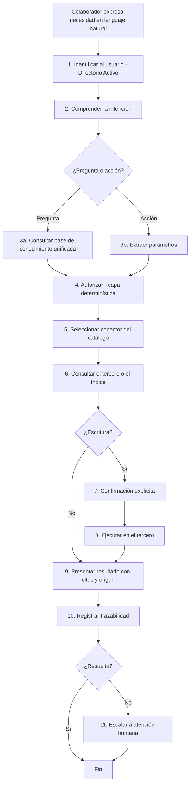

# Requirements Document

> **Documento 1 de 3** del Spec `eva-enterprise-virtual-assistant` — EVA (Enterprise Virtual Assistant).
> Flujo Spec-Driven Development (Kiro): **Requirements → Design → Tasks**.
> Este documento define **qué debe hacer** la solución. No define cómo se construye (ver `design.md`) ni el desglose de trabajo (ver `tasks.md`).
> **Versión 2.0** — Rediseño: EVA como **hub de integración con aplicaciones de terceros** y **base de conocimiento unificada**.

---

## Introduction

**EVA (Enterprise Virtual Assistant)** es el asistente corporativo inteligente de los colaboradores de **Redeban**. Los procesos corporativos ya están resueltos por **aplicaciones de terceros**: **Daruma** (gestión documental), **Skkeda** (gestión de reservas y puestos) y **Jira** (gestión de proyectos), entre otras. El problema no es la ausencia de herramientas sino su **fragmentación**: el colaborador debe saber qué aplicación usar, cómo navegarla y dónde está la información.

Un proceso de validación realizado durante el segundo semestre de 2026 confirmó la necesidad: a partir de **245 entrevistas** a colaboradores, el **90%** percibe una integración compleja entre herramientas, con una **pérdida estimada de 3 a 4 horas por colaborador**.

EVA **no reimplementa** los procesos de los terceros: los **centraliza**. Ofrece un único punto de interacción conversacional que:

1. **Conecta** las aplicaciones de terceros mediante **conectores** gobernados por un catálogo, consumiendo hoy sus **APIs REST** y quedando preparado para integraciones **agente a agente (MCP/A2A)**.
2. **Unifica el conocimiento** en una base de conocimiento que combina el contenido de uso general de todos los conectores, el contenido restringido consultado **en tiempo real** con los permisos del tercero, y una **base de conocimiento propia de EVA** (documentos, rutas y tips).
3. **Ejecuta** acciones sobre los terceros solo después de una autorización determinística y, en escrituras, de la confirmación explícita del colaborador.

Los terceros siguen siendo la **autoridad del dato y de sus reglas de negocio**.

### 1.1 Flujo conceptual de interacción

### 1.2 Convenciones del documento

- Requisitos funcionales como **historias de usuario** con criterios de aceptación en **EARS**: `CUANDO/SI <evento o condición> ENTONCES el sistema DEBE <respuesta>`.
- Obligatoriedad: **DEBE** (obligatorio), **DEBERÍA** (recomendado), **PUEDE** (opcional).
- Identificadores trazables: **RF-xx** (funcional), **RNF-xx** (no funcional), **RS-xx** (seguridad).
- Todo contrato de Daruma y Skkeda descrito aquí es un **SUPUESTO** a validar con el proveedor (ver §9).

---

## 2. Actores del sistema

| Actor | Tipo | Descripción | Interés principal |
|-------|------|-------------|-------------------|
| **Colaborador** | Humano / primario | Empleado de Redeban que consulta conocimiento y solicita acciones en lenguaje natural. | Resolver sin saber qué aplicación usar. |
| **Administrador de EVA** | Humano | Gestiona catálogo de conectores, políticas, configuración y **publica el contenido propio de EVA**. | Operar EVA y su conocimiento de forma segura. |
| **Dueño del proceso** | Humano | Responsable funcional de cada proceso (gestión documental, Workplace, PMO). | Que EVA respete las reglas del tercero. |
| **Operador de soporte** | Humano | Atiende escalamientos. | Recibir casos con contexto suficiente. |
| **Responsable de seguridad** | Humano | Define y supervisa controles de seguridad e IA. | Zero Trust, mínimo privilegio, protección de datos. |
| **Auditor** | Humano | Revisa trazabilidad, confirmaciones y acciones administrativas. | Verificar cumplimiento. |
| **Directorio Activo** | Sistema externo | Fuente de identidad corporativa (Entra ID o AD con ADFS), federada vía OIDC/SAML. | Identificar al colaborador y sus atributos. |
| **Daruma** | Tercero | Gestión documental. Autoridad de documentos y de **sus permisos de acceso**. | Que solo se muestre lo que el usuario puede ver. |
| **Skkeda** | Tercero | Gestión de reservas de puestos y salas. Autoridad de sedes, disponibilidad y reservas. | Que se respeten sus reglas de reserva. |
| **Jira** | Tercero | Gestión de proyectos. Autoridad de proyectos, issues y flujos de trabajo. | Que se respeten sus permisos y flujos. |
| **Conectores futuros** | Terceros | Aplicaciones a incorporar (p. ej. SSTCONTIGO, PIA) sin cambiar el núcleo. | Integrarse con un contrato común. |
| **Agentes de terceros** | Sistema externo (futuro) | Agentes de IA que un tercero exponga vía MCP o A2A. | Interoperar con EVA bajo sus controles. |

---

## Glossary

Vocabulario completo en [`glossary.md`](./glossary.md). Términos esenciales:

| Término | Definición |
|---------|------------|
| **Conector** | Componente que integra un tercero con EVA mediante la interfaz común `ConnectorPort`. |
| **Catálogo de conectores** | Registro versionado de conectores, capacidades, modo de integración, modo de autenticación y fuente de conocimiento. |
| **Capacidad** | Operación declarada de un conector (p. ej. `booking.create`), con esquema, tipo, riesgo y permisos. |
| **Contenido general / restringido** | General: apto para todos los colaboradores, se indexa. Restringido: sujeto a permisos del tercero, solo se consulta en vivo. |
| **Base de conocimiento propia (`eva-native`)** | Contenido creado por los Administradores de EVA: documentos, rutas (de proceso y físicas) y tips. |
| **Policy Engine** | Capa determinística que autoriza o deniega cada acción o consulta. No usa IA. |
| **Mock** | Simulación de un tercero que implementa su contrato canónico, con escenarios de falla, solo en dev/test. |

---

## Requirements

### Épica A — Acceso e identidad

#### RF-01 — Autenticación corporativa con Directorio Activo
**Historia:** Como colaborador, quiero autenticarme con mi cuenta del Directorio Activo, para acceder a EVA con mi identidad y atributos corporativos.

**Criterios de aceptación (EARS):**
1. CUANDO un usuario no autenticado accede a EVA ENTONCES el sistema DEBE redirigirlo al proveedor de identidad respaldado por el Directorio Activo (OIDC/SAML).
2. CUANDO el proveedor devuelve una autenticación válida ENTONCES el sistema DEBE establecer una sesión con el identificador corporativo del colaborador (UPN) y solo los atributos autorizados (grupos, área, sede).
3. SI la autenticación falla o expira ENTONCES el sistema DEBE denegar el acceso y NO DEBE exponer funcionalidad ni datos.
4. CUANDO se crea una sesión ENTONCES el sistema DEBE registrar el evento sin almacenar credenciales.
5. SI la cuenta del colaborador se deshabilita en el Directorio Activo ENTONCES el sistema DEBE rechazar sus solicitudes a más tardar al vencer el token de sesión de vida corta.

#### RF-02 — Identificación del usuario en cada solicitud
**Historia:** Como responsable de seguridad, quiero que cada solicitud quede asociada a un colaborador identificado, para autorizar y trazar en cada capa y en cada tercero.

**Criterios de aceptación (EARS):**
1. CUANDO EVA recibe una solicitud ENTONCES el sistema DEBE resolver la identidad del colaborador desde la sesión autenticada antes de procesarla.
2. SI no es posible resolver la identidad ENTONCES el sistema DEBE rechazar la solicitud y solicitar reautenticación.
3. CUANDO se procesa una solicitud ENTONCES el sistema DEBE propagar la identidad a orquestación, políticas, conectores y trazabilidad; hacia cada tercero, en la forma que declare su modo de autenticación (RF-11).
4. El sistema NO DEBE tomar la identidad del usuario del mensaje, de la propuesta del modelo ni de parámetros; solo del token validado.

### Épica B — Comprensión conversacional

#### RF-03 — Interacción en lenguaje natural
**Historia:** Como colaborador, quiero expresar mi necesidad en lenguaje natural, para no tener que conocer cada aplicación.

**Criterios de aceptación (EARS):**
1. CUANDO el colaborador envía un mensaje en lenguaje natural ENTONCES el sistema DEBE aceptarlo como entrada principal.
2. CUANDO el mensaje es ambiguo o incompleto ENTONCES el sistema DEBE solicitar solo la información indispensable.
3. CUANDO el sistema responde ENTONCES DEBE hacerlo en lenguaje claro, indicando estado, resultado, fuente o siguiente paso.

#### RF-04 — Identificación de intención
**Historia:** Como colaborador, quiero que EVA entienda si pregunto algo o pido una acción, para dirigirme al conocimiento o al conector correcto.

**Criterios de aceptación (EARS):**
1. CUANDO EVA recibe un mensaje ENTONCES el sistema DEBE clasificar la intención entre las capacidades del catálogo y la consulta de conocimiento (`knowledge.query`).
2. SI la intención no corresponde a ninguna capacidad activa ENTONCES el sistema DEBE informarlo y ofrecer alternativas o escalamiento.
3. CUANDO la confianza de la clasificación es baja ENTONCES el sistema DEBE pedir aclaración en lugar de asumir.
4. El modelo de IA DEBE limitarse a clasificar y **proponer** una capacidad; NO DEBE autorizar ni ejecutar (RS-01).

#### RF-05 — Extracción de entidades y parámetros
**Historia:** Como colaborador, quiero que EVA extraiga los datos de mi mensaje, para no repetir información.

**Criterios de aceptación (EARS):**
1. CUANDO se identifica una intención ENTONCES el sistema DEBE extraer los parámetros del esquema de la capacidad (p. ej. término de búsqueda en Daruma, sede y fecha en Skkeda, clave de issue en Jira).
2. SI faltan parámetros obligatorios ENTONCES el sistema DEBE solicitarlos de forma mínima y específica.
3. CUANDO un parámetro no supera validaciones de formato o rango ENTONCES el sistema DEBE rechazarlo y solicitar corrección.

### Épica C — Orquestación y gobierno

#### RF-06 — Catálogo de conectores
**Historia:** Como administrador de EVA, quiero un catálogo versionado de conectores y capacidades, para gobernar qué terceros y operaciones ofrece EVA.

**Criterios de aceptación (EARS):**
1. El sistema DEBE mantener un catálogo que declare por conector: identificador, dominio, versión de contrato, capacidades (esquema de parámetros, tipo lectura/escritura, nivel de riesgo, permisos), modo de integración, modo de autenticación, si es fuente de conocimiento, referencia a credenciales y estado.
2. CUANDO se selecciona una capacidad ENTONCES el sistema DEBE validar que corresponda a un conector **activo** y que los parámetros cumplan su esquema.
3. SI una intención requiere una capacidad no declarada o de un conector inactivo ENTONCES el sistema DEBE rechazar la ejecución.
4. CUANDO un administrador modifica el catálogo ENTONCES el sistema DEBE crear una nueva versión y auditar el cambio (RF-23).

#### RF-07 — Orquestación de conectores
**Historia:** Como colaborador, quiero que EVA coordine el conector adecuado, para obtener una respuesta integral sin cambiar de aplicación.

**Criterios de aceptación (EARS):**
1. CUANDO se validan intención, parámetros y permisos ENTONCES el orquestador DEBE enrutar al conector correspondiente o a la base de conocimiento.
2. CUANDO un flujo requiere pasos determinísticos (validación, confirmación, ejecución, reintentos) ENTONCES el sistema DEBE ejecutarlos en un flujo controlado y auditable.
3. SI un conector no está disponible ENTONCES el sistema DEBE informarlo y ofrecer escalamiento sin dejar la solicitud en estado inconsistente.
4. El orquestador DEBE mantener la **separación entre razonamiento (IA), autorización (políticas) y ejecución (conectores)**.

#### RF-08 — Capa determinística de políticas
**Historia:** Como responsable de seguridad, quiero una capa determinística que autorice cada acción y consulta, para que nada dependa solo del modelo de IA.

**Criterios de aceptación (EARS):**
1. ANTES de ejecutar cualquier acción o consulta el sistema DEBE validar de forma determinística: identidad, permisos sobre el dominio, parámetros, conector y capacidad seleccionados, y nivel de riesgo.
2. SI cualquier validación falla ENTONCES el sistema DEBE denegar y registrar el motivo.
3. CUANDO la acción es de escritura ENTONCES la capa de políticas DEBE exigir evidencia de confirmación explícita (RF-09).
4. CUANDO la solicitud es una consulta de conocimiento ENTONCES la capa de políticas DEBE determinar las fuentes permitidas (índice, contenido propio, consulta en vivo).
5. La capa de políticas NO DEBE delegar la decisión al modelo de IA.

#### RF-09 — Confirmación e idempotencia de escrituras
**Historia:** Como colaborador, quiero confirmar antes de que EVA modifique información en un tercero, para evitar acciones no deseadas.

**Criterios de aceptación (EARS):**
1. CUANDO una operación modifica información en un tercero ENTONCES el sistema DEBE presentar un resumen y solicitar **confirmación explícita**.
2. SI el colaborador no confirma ENTONCES el sistema NO DEBE ejecutar la acción.
3. CUANDO el colaborador confirma ENTONCES el sistema DEBE registrar la **evidencia de confirmación** (quién, qué, cuándo).
4. Las escrituras DEBEN ser **idempotentes**: un reintento con el mismo identificador de operación NO DEBE producir efectos duplicados en el tercero.

### Épica D — Integración con terceros

#### RF-10 — Interfaz común de conectores
**Historia:** Como administrador de EVA, quiero que todos los terceros se integren mediante una interfaz común, para cambiar o agregar proveedores sin afectar el núcleo.

**Criterios de aceptación (EARS):**
1. Todo conector DEBE implementar la interfaz común `ConnectorPort`: invocar una capacidad y, si es fuente de conocimiento, listar contenido para ingesta.
2. El núcleo (orquestador, políticas, flujos) NO DEBE depender del protocolo ni del contrato propio de un tercero.
3. CUANDO el modo de integración es `REST_DIRECT` ENTONCES el conector DEBE consumir la API REST del tercero mediante una **capa anticorrupción** que traduzca entre el contrato canónico y el del proveedor.
4. La arquitectura DEBE admitir los modos `MCP_GATEWAY` y `A2A` activables por configuración del catálogo, sin modificar el núcleo.
5. CUANDO se use MCP o A2A ENTONCES la invocación DEBE originarse en la capa de ejecución después de la autorización; el modelo de IA NO DEBE recibir ni invocar herramientas (RS-01).
6. CUANDO un conector responde ENTONCES DEBE indicar el origen del dato (`live` o `mock`) y una referencia verificable cuando aplique.

#### RF-11 — Autenticación declarada por conector
**Historia:** Como responsable de seguridad, quiero que cada conector declare cómo se autentica ante su tercero, para soportar terceros con mecanismos distintos sin debilitar la identidad del usuario.

**Criterios de aceptación (EARS):**
1. Cada conector DEBE declarar uno de los modos: `DELEGATED_OBO`, `SERVICE_ACCOUNT_USER_CONTEXT`, `THIRD_PARTY_OAUTH` o `NONE` (solo fuentes internas de EVA).
2. CUANDO el modo es `SERVICE_ACCOUNT_USER_CONTEXT` ENTONCES el conector DEBE usar una credencial técnica de Secrets Manager y enviar la identidad del colaborador (UPN del Directorio Activo) en una aserción firmada para que el tercero aplique sus permisos.
3. CUANDO el modo es `THIRD_PARTY_OAUTH` y el colaborador no ha autorizado a EVA ENTONCES el sistema DEBE solicitar su consentimiento mediante el flujo OAuth del tercero antes de ejecutar.
4. CUANDO el modo es `DELEGATED_OBO` ENTONCES el conector DEBE intercambiar el token del usuario por uno delegado con audiencia del tercero.
5. Credenciales, tokens y aserciones NO DEBEN llegar al modelo de IA ni a los logs (RS-07, RS-18).
6. SI la autenticación ante el tercero falla ENTONCES el sistema DEBE informarlo sin detalles técnicos y NO DEBE reintentar con otra identidad.

#### RF-12 — Incorporación de nuevos conectores
**Historia:** Como administrador de EVA, quiero incorporar nuevas aplicaciones de terceros, para ampliar EVA sin rediseñarla.

**Criterios de aceptación (EARS):**
1. CUANDO se incorpora un tercero ENTONCES DEBE bastar con: registrar su contrato, implementar o configurar su adaptador, declararlo en el catálogo, crear su secreto y sus políticas, sin modificar orquestador, Policy Engine ni flujos.
2. CUANDO se registra un conector ENTONCES DEBE quedar **inactivo** y solo activarse tras superar sus pruebas de contrato en el ambiente de pruebas.
3. CUANDO se desactiva un conector ENTONCES sus capacidades DEBEN dejar de ofrecerse y su contenido indexado DEBE retirarse del índice.

### Épica E — Base de conocimiento unificada

#### RF-13 — Ingesta unificada de conocimiento
**Historia:** Como colaborador, quiero que EVA conozca la información de todas las aplicaciones corporativas, para encontrarla en un solo lugar.

**Criterios de aceptación (EARS):**
1. Todo conector declarado como fuente de conocimiento DEBE publicar su contenido con un **contrato común de ingesta** (ítem, texto, metadatos, clasificación, fecha de actualización, URI de origen).
2. CUANDO llega la ejecución programada de un conector ENTONCES el sistema DEBE sincronizar su contenido de forma incremental.
3. El sistema DEBE indexar **solo** ítems que su origen clasifique como `GENERAL`; SI la clasificación falta o es desconocida ENTONCES NO DEBE indexarlo.
4. CUANDO un ítem se elimina, vence o se reclasifica como restringido ENTONCES el sistema DEBE retirarlo del índice en la siguiente sincronización.
5. SI una sincronización falla ENTONCES el sistema DEBE conservar el último estado válido del índice, registrar el fallo y alertar.
6. Un administrador PUEDE solicitar una sincronización bajo demanda de un conector.

#### RF-14 — Consulta híbrida con citas y origen
**Historia:** Como colaborador, quiero hacer preguntas y recibir respuestas con su fuente, para confiar en lo que EVA me dice.

**Criterios de aceptación (EARS):**
1. CUANDO el colaborador hace una pregunta informativa ENTONCES el sistema DEBE combinar el contenido propio de EVA, el contenido general indexado y, si aplica, la consulta en vivo a Daruma.
2. CUANDO responde ENTONCES el sistema DEBE incluir **citas** (título, fuente, enlace) y el **origen** de cada una (`eva`, `index`, `live`, `mock`).
3. La respuesta DEBE basarse solo en el contenido recuperado; SI no hay contenido suficiente ENTONCES el sistema DEBE indicarlo, NO DEBE inventar y DEBE ofrecer escalamiento.
4. CUANDO existen coincidencias equivalentes ENTONCES el sistema DEBE priorizar el contenido propio de EVA vigente.
5. CUANDO la fuente expone fecha de actualización ENTONCES el sistema DEBE mostrarla.

#### RF-15 — Respeto de los permisos de Daruma
**Historia:** Como dueño del proceso documental, quiero que EVA respete los permisos de Daruma, para que nadie vea documentos a los que no tiene acceso.

**Criterios de aceptación (EARS):**
1. El contenido restringido de Daruma DEBE consultarse **solo en tiempo real** vía su API y con la identidad del colaborador.
2. Daruma es la autoridad de permisos: EVA NO DEBE decidir, replicar ni almacenar en caché permisos sobre documentos restringidos.
3. SI Daruma deniega el acceso ENTONCES el sistema NO DEBE mostrar título, fragmento ni existencia del documento.
4. El contenido restringido recuperado NO DEBE persistirse en el índice, la trazabilidad ni el historial; solo identificadores de referencia.
5. SI Daruma no está disponible ENTONCES el sistema DEBE responder solo con contenido general e indicar que la búsqueda restringida no estuvo disponible.

#### RF-16 — Base de conocimiento propia de EVA
**Historia:** Como administrador de EVA, quiero publicar documentos, rutas y tips propios, para orientar a los colaboradores en lo que ninguna aplicación de terceros documenta.

**Criterios de aceptación (EARS):**
1. El sistema DEBE permitir crear, editar, publicar y retirar contenido de tipo `DOCUMENT`, `ROUTE` (subtipo `PROCESS` o `PHYSICAL`) y `TIP`.
2. SOLO los **Administradores de EVA** DEBEN poder gestionar este contenido; SI otro rol lo intenta ENTONCES el sistema DEBE denegar y registrar el intento.
3. El contenido DEBE seguir el ciclo `DRAFT → PUBLISHED → EXPIRED`, con retiro manual a `RETIRED`; solo lo `PUBLISHED` y vigente DEBE ser recuperable.
4. CUANDO se intenta publicar ENTONCES el sistema DEBE validar la ausencia de datos personales, secretos y contenido restringido; SI detecta alguno ENTONCES DEBE rechazar la publicación indicando el motivo.
5. El contenido publicado DEBE ser visible para **todos** los colaboradores autenticados.
6. CUANDO se alcanza la fecha de vigencia ENTONCES el contenido DEBE pasar a `EXPIRED` y retirarse del índice automáticamente.
7. Una ruta `PHYSICAL` DEBE incluir sede, piso, origen, destino y pasos; SI incluye imagen o mapa ENTONCES DEBE incluir texto alternativo.
8. Una ruta `PHYSICAL` PUEDE asociarse a una sede o espacio de Skkeda para ofrecerse tras una reserva (RF-18.8).
9. Una ruta `PROCESS` PUEDE enlazar una capacidad del catálogo para que EVA ofrezca ejecutarla, siempre pasando por la capa de políticas.
10. CUANDO se modifica el contenido ENTONCES el sistema DEBE versionarlo y auditar el cambio.

### Épica F — Casos de uso del MVP

#### RF-17 — CU1: Gestión documental con Daruma
**Historia:** Como colaborador, quiero buscar y consultar documentos corporativos desde EVA, para no navegar Daruma.

**Criterios de aceptación (EARS):**
1. CUANDO el colaborador busca un documento ENTONCES el sistema DEBE consultar el contenido general indexado y Daruma en vivo con su identidad.
2. CUANDO retorna resultados ENTONCES el sistema DEBE mostrar solo metadatos autorizados (título, tipo, versión, fecha, enlace al visor de Daruma) y un resumen basado en contenido accesible.
3. CUANDO el colaborador selecciona un documento ENTONCES el sistema DEBE obtener su detalle (`document.get`) con su identidad.
4. EVA NO DEBE descargar ni almacenar el archivo del documento; DEBE entregar el enlace al visor de Daruma.
5. SI el colaborador solicita subir, aprobar o versionar un documento ENTONCES el sistema DEBE informar que no está disponible en EVA y ofrecer el enlace a Daruma (Roadmap).
6. SI Daruma falla ENTONCES el sistema DEBE informarlo con claridad y ofrecer escalamiento.

#### RF-18 — CU2: Reservas y puestos con Skkeda
**Historia:** Como colaborador, quiero reservar un puesto o sala indicando sede y fecha, para asegurar mi espacio sin usar otro portal.

**Criterios de aceptación (EARS):**
1. CUANDO el colaborador solicita disponibilidad ENTONCES el sistema DEBE consultar Skkeda por sede, fecha, tipo de espacio (puesto o sala), piso y franja horaria.
2. CUANDO existe disponibilidad ENTONCES el sistema DEBE presentar las opciones válidas y permitir seleccionar una.
3. CUANDO se selecciona una opción ENTONCES el sistema DEBE mostrar el resumen y solicitar confirmación explícita.
4. CUANDO se confirma ENTONCES el sistema DEBE crear la reserva en Skkeda (o su mock) de forma idempotente.
5. SI la opción deja de estar disponible (conflicto) ENTONCES el sistema DEBE presentar alternativas.
6. CUANDO la reserva se crea ENTONCES el sistema DEBE retornar una referencia verificable.
7. CUANDO el colaborador lo solicita ENTONCES el sistema DEBE listar sus reservas y permitir cancelarlas con confirmación.
8. CUANDO se confirma una reserva y existe una ruta física publicada para su sede o espacio ENTONCES el sistema DEBE ofrecerla.
9. Las reglas de Skkeda (anticipación, cupos, horarios) son autoridad; el sistema NO DEBE omitirlas.

#### RF-19 — CU3: Gestión de proyectos con Jira
**Historia:** Como colaborador, quiero consultar y gestionar mis issues y proyectos de Jira desde EVA, para hacer seguimiento sin abrir otra herramienta.

**Criterios de aceptación (EARS):**
1. CUANDO el colaborador referencia un issue ENTONCES el sistema DEBE consultarlo en Jira con la autorización del colaborador.
2. CUANDO el colaborador busca issues ENTONCES el sistema DEBE construir la consulta a partir de parámetros validados (proyecto, estado, asignado, sprint) y NO DEBE ejecutar consultas JQL generadas libremente por el modelo.
3. CUANDO el colaborador pide el estado de un proyecto ENTONCES el sistema DEBE presentar un resumen (issues por estado, vencidos, sprint activo).
4. CUANDO el colaborador pide crear un issue, cambiar su estado o comentar ENTONCES el sistema DEBE solicitar confirmación explícita (RF-09).
5. CUANDO retorna información ENTONCES el sistema DEBE devolver solo los campos autorizados.
6. El sistema NO DEBE afirmar que una escritura fue exitosa si Jira no la confirmó.
7. SI el colaborador no ha autorizado a EVA en Jira ENTONCES el sistema DEBE solicitar el consentimiento (RF-11.3).

### Épica G — Confiabilidad y gobierno

#### RF-20 — Trazabilidad extremo a extremo
**Historia:** Como auditor, quiero rastrear cada interacción de principio a fin, para verificar cumplimiento.

**Criterios de aceptación (EARS):**
1. CUANDO ocurre un paso relevante (identidad, intención, autorización, consulta de conocimiento, confirmación, invocación de conector, resultado, escalamiento) ENTONCES el sistema DEBE registrarlo con un **identificador de correlación** común.
2. CUANDO se invoca un conector ENTONCES la trazabilidad DEBE incluir conector, capacidad, modo de integración, origen (`live`/`mock`) y referencia del resultado.
3. CUANDO una acción es de escritura ENTONCES la trazabilidad DEBE incluir la evidencia de confirmación.
4. La trazabilidad NO DEBE contener secretos, tokens, contenido restringido ni datos personales innecesarios.

#### RF-21 — Manejo de errores
**Historia:** Como colaborador, quiero mensajes claros cuando algo falla, para saber qué ocurrió y qué hacer.

**Criterios de aceptación (EARS):**
1. SI un tercero falla o no responde ENTONCES el sistema DEBE informarlo de forma comprensible, sin detalles técnicos sensibles.
2. CUANDO una operación falla parcialmente ENTONCES el sistema DEBE indicar el estado real (no ejecutado, ejecutado, pendiente con referencia).
3. CUANDO ocurre un error transitorio en una operación idempotente ENTONCES el sistema DEBE poder reintentar de forma segura.
4. CUANDO un mensaje no puede procesarse tras los reintentos ENTONCES el sistema DEBE enviarlo a una DLQ.
5. SI un conector falla de forma repetida ENTONCES el sistema DEBE aislarlo (cortocircuito) sin afectar a los demás conectores.

#### RF-22 — Escalamiento humano
**Historia:** Como colaborador, quiero que EVA me conecte con atención humana cuando no puede resolver, para no quedar sin solución.

**Criterios de aceptación (EARS):**
1. CUANDO EVA no puede resolver una solicitud ENTONCES el sistema DEBE ofrecer el escalamiento a soporte.
2. CUANDO se escala ENTONCES el sistema DEBE transferir el contexto relevante (identificador de correlación, intención, conector, parámetros no sensibles y estado).
3. CUANDO se escala ENTONCES el sistema DEBE registrarlo en la trazabilidad.

#### RF-23 — Observabilidad y auditoría
**Historia:** Como operador y auditor, quiero métricas, logs y tableros, para operar y auditar EVA y sus conectores.

**Criterios de aceptación (EARS):**
1. El sistema DEBE emitir logs estructurados, métricas y trazas distribuidas de interacciones, componentes y conectores.
2. El sistema DEBE exponer tableros y alarmas de latencia, errores, uso y fallos **por conector**, frescura de la ingesta, denegaciones de Daruma y contenido propio por vencer.
3. CUANDO se ejecuta una acción administrativa (catálogo, políticas, configuración, contenido propio) ENTONCES el sistema DEBE auditarla de forma inmutable.

### Épica H — Pruebas sin acceso a proveedores

#### RF-24 — Mocks de terceros
**Historia:** Como equipo de desarrollo, quiero mocks de Daruma, Skkeda y Jira, para construir y probar EVA sin acceso a los proveedores.

**Criterios de aceptación (EARS):**
1. DEBE existir un mock por cada conector del MVP que implemente su **contrato canónico** (OpenAPI).
2. Los mocks DEBEN soportar escenarios seleccionables: `ok`, `timeout`, `server_error`, `access_denied`, `conflict`, `rate_limited` y `stale_classification`.
3. Los mocks DEBEN usar solo **datos sintéticos**.
4. Los mocks NO DEBEN desplegarse en producción; SI el pipeline detecta un mock en la configuración de producción ENTONCES DEBE bloquear el despliegue.
5. CUANDO una respuesta proviene de un mock ENTONCES el sistema DEBE informar al colaborador que el origen es simulado.
6. Los contratos DEBEN poder ejecutarse localmente para pruebas de contrato en CI.
7. CUANDO se reciba la documentación oficial de un proveedor ENTONCES DEBE bastar con sustituir su contrato y adaptador y re-ejecutar las pruebas de contrato, sin cambios en el núcleo.

---

## 4. Requisitos no funcionales

| ID | Categoría | Requisito | Criterio verificable |
|----|-----------|-----------|----------------------|
| **RNF-01** | Usabilidad | La aplicación web DEBE ser responsiva en escritorio y móvil. | Viewports de 360px a 1920px sin pérdida de funcionalidad. |
| **RNF-02** | Accesibilidad | La interfaz DEBERÍA cumplir buenas prácticas de accesibilidad (contraste, foco, teclado, ARIA, texto alternativo en rutas físicas). | Revisión de accesibilidad de los flujos del MVP. |
| **RNF-03** | Rendimiento | Las respuestas DEBERÍAN ser fluidas para una conversación. | P95 objetivo documentado y medido: ≤ 5 s consultas, ≤ 8 s consultas híbridas con Daruma en vivo. |
| **RNF-04** | Escalabilidad | DEBE escalar horizontalmente. | Diseño stateless y elástico verificado en prueba de carga. |
| **RNF-05** | Resiliencia | DEBE degradar de forma controlada ante fallos de terceros (timeouts, reintentos, DLQ, cortocircuito por conector, respuesta con contenido indexado si la fuente en vivo falla). | Pruebas de indisponibilidad con escenarios de mock. |
| **RNF-06** | Idempotencia | Las escrituras DEBEN ser idempotentes. | Reintento con misma clave no duplica efectos. |
| **RNF-07** | Observabilidad | Trazabilidad y observabilidad extremo a extremo correlacionadas, incluidos los conectores. | Un identificador de correlación recorre toda la interacción. |
| **RNF-08** | Ambientes | Separación entre desarrollo, pruebas y producción. | Tres ambientes aislados desplegables por IaC. |
| **RNF-09** | Mantenibilidad | APIs, contratos de conectores y catálogo DEBEN estar versionados. | Versión explícita; cambios sin romper consumidores. |
| **RNF-10** | IaC | Toda la infraestructura como código, desplegada de forma automatizada. | `cdk deploy` reproducible desde cero. |
| **RNF-11** | Costos | Componentes administrados de pago por uso y payload mínimo a los modelos. | Sin recursos siempre encendidos innecesarios; fragmentos recuperados limitados. |
| **RNF-12** | Privacidad | Minimizar y proteger datos personales en todo el flujo. | Clasificación y minimización verificadas por diseño. |
| **RNF-13** | Extensibilidad | Incorporar un conector NO DEBE requerir cambios en el núcleo. | Alta de un conector piloto con cambios solo en artefactos del conector. |
| **RNF-14** | Frescura del conocimiento | El contenido indexado DEBE mantenerse actualizado. | Antigüedad máxima configurable por conector (por defecto 24 h); contenido propio publicado recuperable en ≤ 15 min; contenido retirado o reclasificado fuera del índice en la siguiente sincronización. |
| **RNF-15** | Independencia del proveedor | El cambio de contrato o de proveedor DEBE afectar solo al adaptador del conector. | Pruebas de contrato por conector; núcleo sin referencias a contratos de proveedor. |

---

## 5. Requisitos de seguridad (Security by Design, Zero Trust, mínimo privilegio)

| ID | Requisito | Criterio verificable |
|----|-----------|----------------------|
| **RS-01** | El modelo de IA **NO** puede autorizar ni ejecutar; solo clasifica y **propone**. No recibe herramientas MCP ni invoca conectores. | Toda ejecución pasa por el Policy Engine (RF-08). |
| **RS-02** | Una capa determinística DEBE validar usuario, permisos, parámetros, conector, capacidad y riesgo antes de cualquier acción o consulta. | Pruebas de autorización con casos denegados. |
| **RS-03** | Las escrituras DEBEN requerir confirmación explícita y registrar su evidencia. | Evidencia presente en trazabilidad. |
| **RS-04** | Cada conector DEBE tener un **rol IAM independiente** limitado a su secreto e integración. | Revisión IAM por conector; sin permisos cruzados. |
| **RS-05** | Las respuestas de terceros DEBEN tratarse como **entrada no confiable**: validación de esquema, saneamiento y filtro de campos. | Pruebas con respuestas malformadas o maliciosas. |
| **RS-06** | Protección contra **prompt injection** y uso de capacidades no autorizadas. | Guardrails de entrada/salida y validación contra catálogo. |
| **RS-07** | NO incluir **secretos** en prompts, respuestas ni logs. | Revisión de logs/prompts; secretos solo en Secrets Manager. |
| **RS-08** | NO registrar **datos personales innecesarios**; filtrar entradas y salidas. | Filtros de PII verificados. |
| **RS-09** | Evitar **exposición de información entre usuarios**: cada consulta a terceros usa solo la identidad del solicitante. | Pruebas de segregación entre usuarios. |
| **RS-10** | Credenciales de integración en **AWS Secrets Manager** con rotación. | Ninguna credencial en código o variables en claro. |
| **RS-11** | Cifrado **en tránsito y en reposo** (incluido el índice de conocimiento). | TLS 1.2+; KMS en almacenamiento. |
| **RS-12** | Acciones administrativas (catálogo, políticas, contenido propio) **auditables e inmutables**. | CloudTrail + traza de auditoría. |
| **RS-13** | Canal web protegido perimetralmente. | WAF activo. |
| **RS-14** | **Zero Trust**: autenticación y autorización en cada solicitud. | Token validado en cada solicitud. |
| **RS-15** | El contenido indexado o recuperado (de conectores o propio) DEBE tratarse como **no confiable** frente a prompt injection indirecta. | Guardrails sobre contexto recuperado; pruebas con contenido malicioso sembrado. |
| **RS-16** | El contenido **restringido NUNCA** se indexa; ante clasificación ausente o desconocida se aplica denegación por defecto. | Auditoría del índice y prueba `stale_classification`. |
| **RS-17** | Los **mocks están prohibidos en producción**. | Bloqueo en pipeline y aserción en IaC. |
| **RS-18** | Tokens, credenciales y aserciones de terceros **nunca** se exponen al modelo ni al navegador. | Revisión de payloads a Bedrock y respuestas de API. |
| **RS-19** | El contenido propio de EVA DEBE ser solo de uso general y validarse sin PII, secretos ni contenido restringido antes de publicarse. | Validación automática previa a publicación y prueba de rechazo. |

---

## 6. Alcance del MVP

**Incluye:** aplicación web responsiva; autenticación con Directorio Activo; interacción en lenguaje natural; catálogo de conectores; interfaz común `ConnectorPort` con adaptador REST; adaptador MCP/A2A preparado (diseño y prueba de concepto en dev); autenticación declarada por conector; conectores **Daruma** (solo lectura), **Skkeda** y **Jira**; base de conocimiento unificada con ingesta y consulta híbrida; base de conocimiento propia de EVA (documentos, rutas de proceso y físicas, tips); confirmación de escrituras; trazabilidad; manejo de errores; escalamiento; observabilidad; auditoría; controles de seguridad de IA; mocks de los tres terceros; IaC con separación de ambientes; estrategia de pruebas.

### Casos de uso del MVP

| CU | Caso de uso | Conector | Requisito |
|----|-------------|----------|-----------|
| CU1 | Gestión documental | Daruma | RF-15, RF-17 |
| CU2 | Reservas de puestos y salas | Skkeda | RF-18 |
| CU3 | Gestión de proyectos | Jira | RF-19 |
| CU4 | Consulta de conocimiento unificado | Todos + `eva-native` | RF-13, RF-14, RF-16 |

## 7. Fuera del alcance del MVP (y Roadmap)

- **Certificados laborales** y trámites de RRHH. _[Fuera de alcance — se gestionan en otro sistema interno; podrían incorporarse como conector futuro]_
- Escrituras en Daruma: subir, aprobar o versionar documentos. _[Roadmap]_
- Activación en producción de integraciones MCP/A2A con agentes de terceros. _[Roadmap — la arquitectura queda preparada]_
- Conectores adicionales (SSTCONTIGO, PIA, otros). _[Roadmap]_
- Contenido propio con visibilidad restringida por grupos. _[Fuera de alcance — todo el contenido propio es de uso general]_
- Reemplazo o migración de Daruma, Skkeda o Jira. _[Fuera de alcance — son la autoridad del dato]_
- Aprobaciones que omitan las reglas del tercero. _[Fuera de alcance]_
- Acciones transaccionales sin confirmación. _[Prohibido por diseño]_
- Entrenamiento de modelos fundacionales con datos corporativos. _[Fuera de alcance]_
- Despliegue omnicanal (voz, Teams, etc.). _[Roadmap]_
- Autonomía irrestricta de agentes. _[Prohibido por principios de seguridad]_

---

## 8. Matriz de trazabilidad (Requisitos → Casos de uso → Diseño → Tasks)

> **Diseño** referencia secciones de `design.md`; **Tasks** referencia `tasks.md`.

| Requisito | Caso de uso | Diseño | Tasks |
|-----------|-------------|--------|-------|
| RF-01, RF-02 | Transversal | §4.1, §5.4, §11 | T-02, T-05 |
| RF-03, RF-04, RF-05 | Transversal | §4.2, §4.3 | T-06, T-07 |
| RF-06 | Transversal | §5.1, §10 | T-08 |
| RF-07 | CU1–CU4 | §4.2, §4.5 | T-07, T-10 |
| RF-08 | CU1–CU4 | §4.4, §11 | T-09 |
| RF-09 | CU2, CU3 | §4.5, §10 | T-09, T-10 |
| RF-10 | Transversal | §5.2, §5.3 | T-12, T-14 |
| RF-11 | Transversal | §5.4 | T-12 |
| RF-12 | Transversal | §5.5 | T-08, T-27 |
| RF-13 | CU4 | §6.2, §6.3 | T-15 |
| RF-14 | CU4 | §6.4, §6.5 | T-04, T-16 |
| RF-15 | CU1, CU4 | §6.3, §6.4, §8.1, §11 | T-16, T-18, T-21 |
| RF-16 | CU4 | §7 | T-05, T-17 |
| RF-17 | CU1 | §8.1 | T-18 |
| RF-18 | CU2 | §8.2 | T-19 |
| RF-19 | CU3 | §8.3 | T-20 |
| RF-20 | Transversal | §4.6 | T-21 |
| RF-21 | Transversal | §4.5, §12 | T-10, T-22 |
| RF-22 | Transversal | §4.7 | T-22 |
| RF-23 | Transversal | §12 | T-05, T-21, T-23 |
| RF-24 | Transversal | §9 | T-11, T-13 |
| RNF-01, RNF-02 | Transversal | §4.1 | T-04 |
| RNF-03..RNF-07 | Transversal | §4.5, §12 | T-10, T-23, T-26 |
| RNF-08, RNF-10 | Transversal | §13 | T-01, T-24 |
| RNF-09 | Transversal | §5.1, §14 | T-05, T-08 |
| RNF-11, RNF-12 | Transversal | §4.3, §6.4 | T-06, T-21 |
| RNF-13 | Transversal | §5.5 | T-08, T-27 |
| RNF-14 | CU4 | §6.5 | T-15, T-23 |
| RNF-15 | Transversal | §5.2, §9 | T-11, T-26 |
| RS-01..RS-19 | Transversal | §11 | T-03, T-09, T-12, T-24, T-25 |

---

## 9. Supuestos y dependencias

- El **Directorio Activo** está disponible como IdP federable a Amazon Cognito: Entra ID (OIDC) o AD on-premise con ADFS (SAML). Expone el UPN y los grupos como atributos.
- **No existe documentación de las APIs de Daruma ni de Skkeda.** Sus contratos son **canónicos y supuestos**, a validar con cada proveedor. Se asume que ambos exponen APIs REST con TLS y aceptan una cuenta de servicio que actúe en contexto de un usuario identificado por UPN.
- Se asume que **Daruma** expone búsqueda con la identidad del usuario, aplica sus permisos y declara una **clasificación** por documento que permite distinguir contenido general de restringido.
- Se asume que **Skkeda** expone sedes, disponibilidad, reglas de reserva y reservas por usuario.
- **Jira** se integra con su API REST v3 pública (Jira Cloud) y OAuth 2.0 (3LO). Si Redeban usa Jira Data Center, el adaptador cambia sin afectar el núcleo.
- En esta etapa **no hay acceso a los proveedores**: dev y test operan con mocks.
- Los terceros son la **autoridad del dato y de sus reglas**; EVA no las reemplaza.
- Se dispone de cuentas AWS con permisos para desplegar los servicios vía IaC, en una región que ofrezca los servicios requeridos (validar disponibilidad de Amazon Bedrock Knowledge Bases y AgentCore Gateway).
- Canal único del MVP: **web**.

## 10. Criterios de aceptación global del MVP

El MVP se considera **aceptado** cuando:
1. Un colaborador autenticado con el Directorio Activo completa **CU1 a CU4** extremo a extremo contra los mocks (y contra los terceros reales cuando estén disponibles).
2. Toda **acción de escritura** exige confirmación explícita y registra su evidencia.
3. Ninguna acción ni consulta se ejecuta **sin pasar por la capa determinística de políticas**.
4. Cada interacción es **trazable** con un identificador de correlación.
5. Los controles **RS-01 a RS-19** están implementados y verificados.
6. La solución se despliega mediante **IaC** en ambientes separados y **ningún mock existe en producción**.
7. Ningún contenido restringido existe en el índice, verificado con el escenario `stale_classification`.
8. Un **conector piloto** se incorpora sin cambios en el núcleo.
